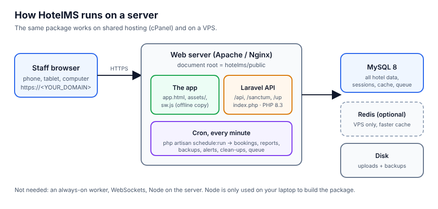

# HotelMS deployment guide

This guide puts HotelMS on the internet, step by step, for someone who has never done it before.
There are two ways. Read this page first, choose one, then follow that guide only:

| Guide | For |
|---|---|
| **[shared-hosting.md](shared-hosting.md)** | A cPanel hosting account (the easiest and usually the cheapest start). |
| **[vps.md](vps.md)** | Your own small server (VPS) with Ubuntu 24.04 – more control, more speed, more work. |

Both guides end with the same **go-live checklist** and a **"first 24 hours"** section.
They are based on the real project files (`deploy/package.sh`, `backend/.env.production.example`,
`backend/routes/console.php`, `backend/public/.htaccess`, `docs/hosting.md`). Anything that depends on your host
and that this guide cannot know is marked **CHECK**.

## The one rule that decides where you may host

> **Guest data must stay on servers in Ethiopia** (Proclamation 1321/2024 – see `docs/hosting.md`).
> Before you pay anyone, ask the host: *"Are your servers physically in Ethiopia?"* Get the answer in writing.
> This also applies to off-server backups. **CHECK** with a lawyer if you are unsure.

## What HotelMS needs (both options)

| Need | Exactly | Why |
|---|---|---|
| PHP | **8.3** (`composer.json`: `"php": "^8.3"`) | Laravel 13 needs it. 8.2 or older will not start. |
| PHP extensions | `pdo_mysql`, `bcmath`, `mbstring`, `openssl`, `zip`, `zlib`, `intl`, `fileinfo`, `ctype`, `curl`, `dom`, `tokenizer`, `xml` (+ `opcache` for speed; `gd` is listed in `docs/hosting.md` – optional, no code uses it today) | `bcmath` = all money maths, `zip` = Excel downloads, `zlib` = backups, `pdo_mysql` = database. Without `bcmath` the app fails with *"Call to undefined function App\Support\bcadd()"*. |
| PHP limits | `upload_max_filesize` ≥ 9M, `post_max_size` ≥ 10M, `memory_limit` ≥ 256M | Payment proofs and guest ID photos may be up to 8 MB. PHP's default (2 MB) is too small. |
| Database | **MySQL 8** (or MariaDB 10.6+) | All data. Backups are made in plain PHP – no `mysqldump` needed – but they **need MySQL** (not SQLite). |
| HTTPS | A certificate (free: AutoSSL / Let's Encrypt) | Sign-in cookies are "secure only" (`SESSION_SECURE_COOKIE=true`); the installable/offline app needs HTTPS. |
| Cron | One line, **every minute** | Expiring bookings, reports, alerts, backups, clean-ups and the queue all run from it. |
| Disk | Start with **10 GB** free (CHECK: grows with uploads and 30 days of backups) | The app warns in Super Admin → System when less than **500 MB** is free. |
| Your laptop | Windows + WSL (Ubuntu) or Linux/macOS with PHP 8.3, Composer, **Node 22**, `zip`, `rsync` | To build the package (`./deploy/package.sh`). Node is never needed on the server. |

**Not needed:** Redis (optional on a VPS), an always-on queue worker, WebSockets, Node on the server, root access
(shared hosting). The app was built so that **one cron line** does all background work.

## Shared hosting or VPS?

| | Shared hosting (cPanel) | VPS (Ubuntu 24.04) |
|---|---|---|
| **Difficulty** | Easiest. Click-through cPanel screens. | Harder. You type commands and you are responsible for security updates. |
| **Time to first launch** | About 1–2 hours (CHECK) | About 3–5 hours the first time (CHECK) |
| **Speed** | Fine for 1–3 small hotels (CHECK) | Better; can add Redis; you choose the size |
| **Background work** | cron every minute (supported) | cron or a systemd timer, or Docker's scheduler service |
| **Redis** | Usually not available – the app uses the database instead (built in) | Yes (optional) |
| **SSH / terminal** | Sometimes. The guide also shows how to do it **without SSH**. | Always |
| **Backups** | The app's own backups + cPanel backups | The app's own backups + a copy to another place (script included) |
| **Who fixes the server** | The host (PHP updates, hardware) | You |
| **Cost** | Lower monthly price (CHECK with hosts) | Higher monthly price (CHECK with hosts) |
| **Good for** | First hotels, a pilot, the demo | 5+ hotels, growing, more control |

**Recommendation:** start on **shared hosting** if a good Ethiopian cPanel host gives you PHP 8.3, MySQL 8,
SSH (or at least "Terminal") and cron every minute. Move to a **VPS** when you have about 5 or more active hotels,
when pages feel slow at busy times, or when the host's limits get in the way. The same package works on both, and
moving is: backup → restore on the new server (`php artisan hotelms:backup --restore=…`) + copy the uploaded files.

## Cost – fill in with real offers

This guide does not invent prices. Ask 2–3 hosts in Ethiopia and fill in:

| Item | Shared hosting | VPS |
|---|---|---|
| Hosting per month | `<PRICE_FROM_HOST>` | `<PRICE_FROM_HOST>` (size: see vps.md) |
| Domain per year | `<PRICE_FROM_REGISTRAR>` | `<PRICE_FROM_REGISTRAR>` |
| SSL certificate | free (AutoSSL / Let's Encrypt) | free (Let's Encrypt) |
| Off-server backup storage | often included (CHECK) | `<PRICE_FROM_PROVIDER>` (must be in Ethiopia) |
| Email sending | usually included (cPanel mailboxes) | your host's SMTP or a mail service (CHECK) |

## Questions to ask a host before you pay

1. Are the servers physically in Ethiopia? (required)
2. Is **PHP 8.3** available, and can I choose it per domain? Which extensions can I switch on (`bcmath`, `intl`, `zip`, `pdo_mysql`, `opcache`)?
3. MySQL version? (8.0+ or MariaDB 10.6+)
4. Do I get **SSH** or cPanel **Terminal**? (Not required, but makes everything easier.)
5. Can cron jobs run **every minute**? (Some hosts allow only every 5 or 15 minutes – then bookings expire and alerts arrive later; CHECK.)
6. Can I set the **document root** of a domain or subdomain to a folder I choose (e.g. `hotelms/public`)?
7. Is AutoSSL / Let's Encrypt included?
8. Upload limit in File Manager (the package is a zip of several MB – CHECK its size after you build it).
9. Can PHP make outgoing HTTPS connections (Telegram messages use `api.telegram.org`)?
10. Are backups included, how often, and where are they stored?
11. (VPS) Ubuntu 24.04 LTS available? Snapshots? Is the IPv4 address included?

## Words used in this guide

| Word | Meaning |
|---|---|
| **Package** | `hotelms.zip`, made on your laptop by `./deploy/package.sh`. It holds the backend, the built app and `vendor/`. |
| **Document root** | The folder the web server shows for your domain. For HotelMS it must be `hotelms/public`. |
| **`.env`** | The settings file (passwords, domain, mail). Secret – never share it, never put it in Git. |
| **`APP_KEY`** | A secret key made once. Guest ID numbers, two-step secrets and backups depend on it. **Keep a copy in a safe place. Never change it.** |
| **artisan** | Laravel's command tool: `php artisan …`, always run inside the `hotelms` folder. |
| **Cron** | The server's timer. HotelMS needs one line that runs every minute. |
| **Placeholder** | Text like `<YOUR_DOMAIN>` – replace it (including the `< >`) with your own value. |

## How these PDFs and files are made

The guides are Markdown files in this folder (`deploy-guide/`, not part of the app build: `deploy/package.sh` only
packs `backend/` and `docs/`). The PDFs in `pdf/` are made with `./build-pdf.sh`. Ready-to-use server files
(Nginx, Docker, deploy script, backup script) are in `files/`.
