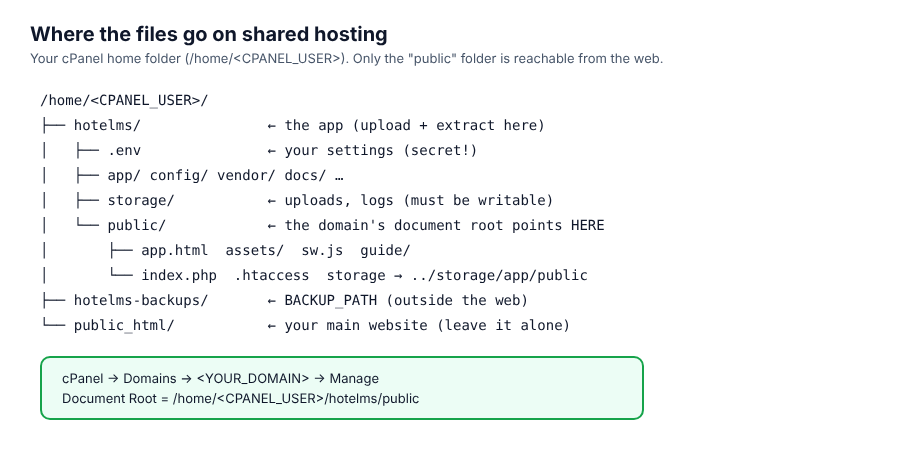
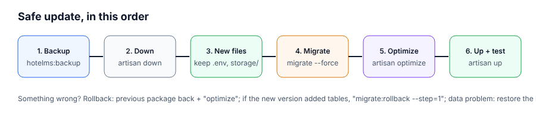

# HotelMS on shared hosting (cPanel)

Follow the parts in order. Every step has **the exact thing to type or click** and **what you should see**.
If what you see is different, stop and look at [Troubleshooting](#troubleshooting).

cPanel looks a little different from host to host (themes, CloudLinux, menu names). The names here are cPanel's
standard names (theme "Jupiter"). If you cannot find a menu, use the **search box at the top of cPanel** and type
the name. Things this guide cannot know about your host are marked **CHECK**.

> There are no real cPanel screenshots in this guide (no cPanel account was available to make them). The pictures
> are simple drawings. Your screens may look different; the menu names are the same.

## Your placeholders

Write your values here first. Replace every `<…>` in this guide with them (including the `< >`).

| Placeholder | Meaning | Example (not real) |
|---|---|---|
| `<YOUR_DOMAIN>` | The address staff will open | `app.example.et` |
| `<CPANEL_USER>` | Your cPanel user name (top right in cPanel, or "General Information") | `examplehot` |
| `<PHP_PATH>` | Full path of PHP 8.3 on your host (Part E, step 2) | `/opt/cpanel/ea-php83/root/usr/bin/php` |
| `<DB_NAME>` | Database name (cPanel adds `<CPANEL_USER>_` in front) | `examplehot_hotelms` |
| `<DB_USER>` | Database user (also with the prefix) | `examplehot_hms` |
| `<DB_PASSWORD>` | The database user's password (make a long random one) | – |
| `<APP_KEY>` | Made by `php artisan key:generate` (starts with `base64:`) | – |
| `<MAIL_HOST>` | Your outgoing mail server (Part H) | `mail.example.et` |
| `<MAIL_PORT>` | `465` (SSL) or `587` (STARTTLS) | `465` |
| `<MAIL_USER>` | The mailbox that sends emails | `no-reply@example.et` |
| `<MAIL_PASSWORD>` | That mailbox's password | – |
| `<SUPER_ADMIN_EMAIL>` | Your own email for the Super Admin account | `owner@example.et` |
| `<YOUR_LAPTOP_USER>` | Your user name in WSL / Linux on your laptop | `hashim` |

**Never put real passwords in this document, in a chat or in an email.** Keep them in a password manager.

## Contents

- Part A – Before you start (what to check with your host)
- Part B – Build the package on your laptop
- Part C – Prepare cPanel: PHP version, domain, database
- Part D – Upload the files
- Part E – The `.env` settings file
- Part F – First start: key, database, Super Admin
- Part G – Cron (background work) and the queue
- Part H – HTTPS, permissions, email
- Part I – Sign in and finish
- Part J – Updating to a new version
- Part K – Backups and restore
- Part L – Rollback
- Troubleshooting
- Go-live checklist · First 24 hours · Security

---

## Part A – Before you start

### A1. Check with your host (send them this list)

| Ask | Needed answer | If not |
|---|---|---|
| Servers in Ethiopia? | **Yes** (data law) | Choose another host. |
| PHP 8.3 available? | Yes | HotelMS will not run. |
| Extensions `bcmath`, `intl`, `zip`, `pdo_mysql`, `mbstring`, `fileinfo`, `opcache` | Can be switched on | Ask the host to switch them on. |
| MySQL 8.0+ or MariaDB 10.6+ | Yes | Choose another host. |
| Cron every minute | Yes | Every 5 minutes also works, but bookings expire and alerts arrive later (CHECK). |
| Document root of a (sub)domain can point to any folder | Yes | Use the "no custom document root" way in Part C3. |
| SSH or cPanel **Terminal** | Nice to have | Use the **"no SSH"** boxes in this guide. |
| Outgoing HTTPS from PHP | Yes | Telegram messages will not work (email still works). |
| PHP's `symlink()` function allowed | Yes | `storage:link` fails → uploaded logos do not show (CHECK, Troubleshooting). |

### A2. What does NOT work on shared hosting – and what the app does instead

| Usually not available | HotelMS uses instead (already built in) |
|---|---|
| Redis | The **database** for cache, sessions and the queue (`CACHE_STORE=database`, `SESSION_DRIVER=database`, `QUEUE_CONNECTION=database` – already in `.env.production.example`). |
| An always-running queue worker (Supervisor) | The **cron line** runs `queue:work --stop-when-empty --max-time=50` every minute (`backend/routes/console.php`). Today nothing is put on the queue at all; it is a safety net. |
| WebSockets | Not used. Live screens ask the server again every few seconds. |
| `mysqldump` | Not needed. `php artisan hotelms:backup` writes the backup in plain PHP. |
| Node.js | Not needed on the server. You build the app on your laptop (Part B). |

---

## Part B – Build the package on your laptop

You do this on your own computer, not on the host. The result is one file: `hotelms.zip`.

### B1. Open WSL (Windows) and check the tools

On Windows, open **Ubuntu** (WSL) from the Start menu. Type:

```sh
php -v
composer --version
node -v
zip -v | head -1
rsync --version | head -1
```

**You should see:** `PHP 8.3.x`, `Composer version 2.x`, `v22.x`, and a version line for zip and rsync.

If something is missing (Ubuntu 24.04 in WSL – CHECK your WSL version with `lsb_release -a`):

```sh
sudo apt update
sudo apt install -y php8.3-cli php8.3-mbstring php8.3-xml php8.3-zip php8.3-intl php8.3-bcmath php8.3-curl php8.3-mysql composer zip unzip rsync git
```

Node 22 is not in Ubuntu's own list. One common way (CHECK – or see nodejs.org for other ways):

```sh
curl -fsSL https://deb.nodesource.com/setup_22.x | sudo -E bash -
sudo apt install -y nodejs
node -v
```

**You should see:** `v22.` followed by numbers.

### B2. Get a clean copy of the code

Build from a **fresh copy** of `main`, not from the folder you use for development: then you know exactly which
version goes online. (The package script leaves your local `.env`, uploads, logs and caches out either way.)

```sh
cd ~
rm -rf hotelms-release
git clone https://github.com/kulmiss/hotelms.git hotelms-release
cd hotelms-release
git checkout main
git log --oneline -1
```

**You should see:** the newest commit of `main` (the release you want to put online). GitHub may ask you to sign in
because the repository is private.

### B3. Build

```sh
./deploy/package.sh
```

This takes a few minutes. **You should see** these lines, in this order, and no red `ERROR`:

```
1/4 Web app
2/4 API
   Developer docs (Super Admin → Developer docs; not public)
3/4 Web app into public/ (as app.html, so / opens the app and /api stays Laravel)
4/4 Zip
Done: build/hotelms.zip – see docs/hosting.md
```

### B4. Check the package

```sh
ls -lh build/hotelms.zip
ls build/hotelms/public/guide | wc -l
ls build/hotelms/storage/app/private
```

**You should see:** the size of `hotelms.zip`, `15` (the staff-guide pictures), and nothing for the last line
(no uploads from your computer). The package never holds your `.env`, uploads, logs or caches (`deploy/package.sh`;
CI checks this whenever the app or the package script changes).

### B5. Make the secret key now (for hosts without SSH)

```sh
cd build/hotelms
php artisan key:generate --show
cd ../..
```

**You should see:** one line that starts with `base64:` – this is your `<APP_KEY>`. Copy it into your password
manager **now**. (This command does not save anything; it only shows a new key. Tested.)

### B6. Find the zip in Windows

```sh
explorer.exe build
```

A Windows Explorer window opens with `hotelms.zip`. You will upload this file in Part D.

---

## Part C – Prepare cPanel

Sign in to cPanel (your host sends you the address, often `https://<your host>:2083`).

### C1. Choose PHP 8.3

One of these two menus exists on your host (CHECK which):

**"MultiPHP Manager"** (standard cPanel):

1. Search **MultiPHP Manager** and open it.
2. Tick the box next to `<YOUR_DOMAIN>` (if the domain does not exist yet, do C2 first and come back).
3. In "PHP Version" choose **PHP 8.3** (sometimes called `ea-php83`) → **Apply**.

**"Select PHP Version"** (hosts with CloudLinux):

1. Search **Select PHP Version** and open it.
2. "Current PHP version": choose **8.3** → **Set as current**.
3. Tab **Extensions**: tick `bcmath`, `intl`, `mbstring`, `pdo_mysql`, `zip`, `fileinfo`, `opcache` (and `gd`, optional). Changes save by themselves.

**You should see:** PHP 8.3 next to your domain.

### C2. Raise the PHP limits

Search **MultiPHP INI Editor** (or "Select PHP Version" → tab **Options**). Choose your domain and set:

| Setting | Value |
|---|---|
| `upload_max_filesize` | `9M` (or more) |
| `post_max_size` | `10M` (or more) |
| `memory_limit` | `256M` |
| `max_execution_time` | `60` |

Click **Apply / Save**. *Why:* payment proofs and guest ID photos can be up to 8 MB; PHP's default limit is 2 MB.

Speed (from `docs/hosting.md`): if you see `opcache.memory_consumption`, set it to `128` or more, and
`opcache.max_accelerated_files` to `20000`.

### C3. Create the (sub)domain and point it at `hotelms/public`

The web server must show the `public` folder **inside** the app – never the whole app folder.

**Recommended – a subdomain** like `app.example.et`:

1. Search **Domains** and open it → **Create A New Domain**.
2. Domain: `<YOUR_DOMAIN>`.
3. **Untick** "Share document root (/home/<CPANEL_USER>/public_html) with …".
4. Document Root: `hotelms/public` (cPanel shows `/home/<CPANEL_USER>/` in front).
5. **Submit**.

**You should see:** `<YOUR_DOMAIN>` in the list with document root `/home/<CPANEL_USER>/hotelms/public`. cPanel
creates the empty folder; that is fine – the upload in Part D fills it.



**If your host does not let you choose a document root** (from `docs/hosting.md`): after Part D, move everything
inside `hotelms/public` into `public_html`, then edit `public_html/index.php` and change the two
`__DIR__.'/../` paths to `__DIR__.'/../hotelms/`. This makes updates harder (you repeat it each time) – prefer a
host that allows a document root.

**DNS:** if the domain is managed by this host, nothing else is needed. If the domain's DNS is somewhere else, add an
**A record** there: name `app` (the part before your domain), value = the server IP shown in cPanel →
**General Information → Shared IP Address**. Changes can take up to a few hours (CHECK).

### C4. Create the database and the database user

1. Search **MySQL® Databases** and open it (or "Database Wizard").
2. **Create New Database:** type `hotelms` → **Create Database**. cPanel shows the full name, e.g.
   `<CPANEL_USER>_hotelms` → this is `<DB_NAME>`.
3. **Add New User:** user name `hms` → full name `<CPANEL_USER>_hms` = `<DB_USER>`. Click **Password Generator**,
   tick "I have copied this password", keep it in your password manager = `<DB_PASSWORD>` → **Create User**.
4. **Add User To Database:** choose `<DB_USER>` and `<DB_NAME>` → **Add** → tick **ALL PRIVILEGES** →
   **Make Changes**.

**You should see:** under "Current Databases", `<DB_NAME>` with `<DB_USER>` listed as a privileged user.

---

## Part D – Upload the files

### D1. Upload and extract

1. Search **File Manager** and open it. You start in `/home/<CPANEL_USER>` (your home folder). Stay here –
   **not** in `public_html`.
2. Click **Settings** (top right) → tick **Show Hidden Files (dotfiles)** → **Save**.
3. Click **Upload** → choose `hotelms.zip` from Part B6. Wait for the green 100 %.
   *If the upload stops or is refused:* the File Manager limit may be too small (CHECK) – use an FTP program
   (e.g. FileZilla, with the FTP account from cPanel → **FTP Accounts**) to upload the zip into your home folder.
4. Back in File Manager, click `hotelms.zip` once → **Extract** → extract to `/home/<CPANEL_USER>` → **Extract Files**.

**You should see:** a folder `hotelms` in your home folder with `app`, `bootstrap`, `config`, `database`, `docs`,
`public`, `resources`, `routes`, `storage`, `vendor`, `artisan`, `.env.production.example` and more.
`hotelms/public` holds `app.html`, `assets`, `guide`, `index.php`, `.htaccess`, `sw.js`.

5. Delete `hotelms.zip` from the home folder (keep your copy on the laptop – you need it for a rollback).

> **No Composer needed:** the zip already contains `vendor/` (the package script runs `composer install --no-dev`
> for you). Never run `composer install` on the host unless you know why.

### D2. Make a backups folder

In File Manager, in your home folder: **+ Folder** → name `hotelms-backups` → **Create New Folder**.
It must be **outside** `public_html` and outside `hotelms/public`.

---

## Part E – The `.env` settings file

### E1. Create it

1. In File Manager open `hotelms`.
2. Right-click `.env.production.example` → **Copy** → copy to `/hotelms/.env` (type the new name `.env`).
3. Right-click `.env` → **Edit** → **Edit**.

### E2. Find the PHP 8.3 path (needed for the cron line and for commands – do it now)

With **Terminal** (cPanel → search **Terminal**) or SSH, type:

```sh
php -v
ls -1 /opt/cpanel/ea-php83/root/usr/bin/php /opt/alt/php83/usr/bin/php /usr/local/bin/php 2>/dev/null
```

**You should see:** a version line and one or more paths. Use the one for **8.3**:

- `/opt/cpanel/ea-php83/root/usr/bin/php` (standard cPanel, "EasyApache"), or
- `/opt/alt/php83/usr/bin/php` (CloudLinux).

Check it: `/opt/cpanel/ea-php83/root/usr/bin/php -v` must print `PHP 8.3.…`. That full path is `<PHP_PATH>`.
If plain `php -v` already prints 8.3 in Terminal, `php` works in Terminal – but cron may still use another version,
so use `<PHP_PATH>` in cron anyway. **No Terminal?** Ask your host: *"What is the full path of PHP 8.3 for cron jobs?"*

### E3. Fill it in – every line explained

Change the values on the right. Lines not shown here: leave them as they are.

| Line | Put | Why |
|---|---|---|
| `APP_NAME=HotelMS` | keep (or your product name) | Name in emails. The name, logo and colour on screen come from Super Admin → Branding. |
| `APP_ENV=production` | keep | Production mode. |
| `APP_KEY=` | `<APP_KEY>` (from B5) **or** leave empty and run `key:generate` in Part F | Encrypts sessions, guest ID numbers, two-step secrets, backups' secrets. **Make once, never change, keep a copy.** |
| `APP_DEBUG=false` | keep **false** | `true` shows internals to anyone and is slow. Never `true` on a live server. |
| `APP_URL=` | `https://<YOUR_DOMAIN>` | Links in emails, file addresses. |
| `FRONTEND_URL=` | `https://<YOUR_DOMAIN>` | Same domain as the app. |
| `LOG_CHANNEL=daily` | keep | One log file per day in `storage/logs/` (`laravel-YYYY-MM-DD.log`). |
| `LOG_LEVEL=warning` | keep | Only warnings and errors. |
| `DB_CONNECTION=mysql` | keep | MySQL. |
| `DB_HOST=127.0.0.1` | keep (or `localhost` – CHECK if 127.0.0.1 does not connect) | The database is on the same server. |
| `DB_PORT=3306` | keep | |
| `DB_DATABASE=` | `<DB_NAME>` | From C4 (with the prefix). |
| `DB_USERNAME=` | `<DB_USER>` | From C4 (with the prefix). |
| `DB_PASSWORD=` | `<DB_PASSWORD>` | From C4. If it contains `#` or spaces, put it in double quotes: `"…"`. |
| `SESSION_DRIVER=database` | keep | Sessions in the database (no Redis on shared hosting). |
| `SESSION_LIFETIME=480` | keep | Minutes until an idle sign-in ends (8 hours). |
| `SESSION_SECURE_COOKIE=true` | keep | Cookies only over HTTPS. You **must** have HTTPS (Part H). |
| `SESSION_DOMAIN=` | `<YOUR_DOMAIN>` | Exactly the domain staff open (no `https://`, no `/`). |
| `SANCTUM_STATEFUL_DOMAINS=` | `<YOUR_DOMAIN>` | The app's sign-in works only from this domain. |
| `CACHE_STORE=database` | keep | Cache in the database (no Redis). |
| `QUEUE_CONNECTION=database` | keep | Queued work (if any) is run by the cron line. `sync` also works (runs at once) – keep `database`. |
| `MAIL_MAILER=smtp` | keep | |
| `MAIL_HOST=` | `<MAIL_HOST>` | Part H3. |
| `MAIL_PORT=587` | `<MAIL_PORT>` | `465` or `587`. |
| `MAIL_USERNAME=` | `<MAIL_USER>` | The full email address. |
| `MAIL_PASSWORD=` | `<MAIL_PASSWORD>` | |
| `MAIL_FROM_ADDRESS=` | `<MAIL_USER>` | Must be the same mailbox (or a domain allowed to send). |
| `MAIL_FROM_NAME="${APP_NAME}"` | keep | |
| `SUPER_ADMIN_EMAIL=` | `<SUPER_ADMIN_EMAIL>` | Your owner account, made by `db:seed`. |
| `SUPER_ADMIN_PASSWORD=` | **leave empty** | Then a random temporary password is shown once by `db:seed` (Part F). You must change it at the first sign-in either way. |
| `HOTELMS_TWO_FACTOR_ADMINS=true` | keep | Two-step sign-in for the HotelMS team and Hotel Admins. |
| `TRUSTED_PROXIES=` | keep **empty** | Only if a proxy or CDN (e.g. Cloudflare) sits in front of the host. Empty = trust nobody, so nobody can fake their IP. |
| `BACKUP_PATH=` | `/home/<CPANEL_USER>/hotelms-backups` | From D2. Outside the web. |
| `BACKUP_COPY_PATH=` | empty, or a second folder/disk (CHECK what your host offers) | A second copy of each backup. |
| `BACKUP_KEEP_DAYS=30` | keep | Daily backups kept 30 days (hourly ones 48 hours). |

**Add this line** for port 465 only (SSL): `MAIL_SCHEME=smtps`. For port 587 do not add it.

Click **Save Changes**, then close the editor.

### E4. Protect `.env`

Right-click `.env` → **Change Permissions** → set **640** (owner read/write, group read) → **Change Permissions**.
(If the site shows an error after this, use **644** – CHECK: some hosts run PHP under another group.)
`.env` is never reachable from the web, because only `hotelms/public` is the document root.

---

## Part F – First start: key, database, Super Admin

### F1. With Terminal / SSH (easiest)

Open cPanel → **Terminal** (or connect with SSH). Type each line, one at a time. Use `<PHP_PATH>` if plain `php`
is not 8.3.

```sh
cd ~/hotelms
php -v
```

**You should see:** `PHP 8.3.…`. If not, use `<PHP_PATH>` instead of `php` in every command below.

```sh
php artisan key:generate
```

(Skip this if you already put `<APP_KEY>` into `.env` in E3.) **You should see:**
`INFO  Application key set successfully.` **Now copy the `APP_KEY=` line from `.env` into your password manager.**

```sh
php artisan migrate --force
```

**You should see:** `INFO  Preparing database.`, then a long list of lines ending in `DONE`, the last one
`2026_11_24_000001_create_idempotency_keys_table … DONE`.

```sh
php artisan db:seed --force
```

**You should see:** `Super Admin created: <SUPER_ADMIN_EMAIL> / temporary password: …` – **write the temporary
password down now**, it is shown only once. This also builds the **demo hotel** ("Sheger Demo Hotel": 60 rooms, a year
of bookings), so it can take a few minutes. It is safe to run again (nothing is overwritten).

```sh
php artisan storage:link
```

**You should see:** `INFO  The [public/storage] link has been connected to [storage/app/public].`

```sh
php artisan optimize
```

**You should see:** `INFO  Caching framework bootstrap, configuration, and metadata.` and four lines
`config … DONE`, `events … DONE`, `routes … DONE`, `views … DONE`.

(The outputs above were checked on a copy of the project; only `db:seed` could not be run to the end there.)

### F2. Without SSH or Terminal

You run the same commands **once** through a temporary cron job:

1. Make sure `.env` has `APP_KEY=` filled in (from B5). Without SSH you cannot run `key:generate` interactively.
2. cPanel → **Cron Jobs** → "Add New Cron Job" → Common Settings: **Once Per Minute (\* \* \* \* \*)**.
3. Command (one line; replace both placeholders):

```
cd /home/<CPANEL_USER>/hotelms && ( <PHP_PATH> artisan migrate --force ; <PHP_PATH> artisan db:seed --force ; <PHP_PATH> artisan storage:link ; <PHP_PATH> artisan optimize ) >> /home/<CPANEL_USER>/hotelms-setup.log 2>&1
```

4. **Add New Cron Job**. Wait 2–3 minutes.
5. File Manager → open `hotelms-setup.log` in your home folder (right-click → **View**). You should see the same
   lines as in F1, including `Super Admin created: … / temporary password: …`.
6. **Delete this cron job now** (Cron Jobs → "Current Cron Jobs" → **Delete**). Running it every minute is harmless
   but useless. Then **delete `hotelms-setup.log`** (it contains the temporary password).

### F3. File permissions

In File Manager, folders should be **755** and files **644** (the zip keeps this). These two folders must be
writable by PHP: `hotelms/storage` and `hotelms/bootstrap/cache`. On most cPanel hosts PHP runs as your own user, so
**755** is enough (CHECK). Never use 777.

---

## Part G – Cron (background work) and the queue

### G1. The cron line

1. cPanel → **Cron Jobs**.
2. "Cron Email": leave it empty or put an address you read (cron sends an email only when a command prints
   something; the line below prints nothing).
3. **Add New Cron Job** → Common Settings: **Once Per Minute (\* \* \* \* \*)**.
4. Command:

```
cd /home/<CPANEL_USER>/hotelms && <PHP_PATH> artisan schedule:run >> /dev/null 2>&1
```

5. **Add New Cron Job**.

**You should see:** the line under "Current Cron Jobs" with `* * * * *`.

**Why the full PHP path:** the scheduler starts its jobs with the same PHP that runs it. If cron's plain `php` is an
older version, every job fails. (Checked: `schedule:run` starts the jobs with the same PHP binary.)

**What it runs** (from `backend/routes/console.php`, times in **UTC** – Addis Ababa is UTC+3):

| How often | What |
|---|---|
| every minute | expire unpaid bookings, report automation, run queued work (`queue:work --stop-when-empty --max-time=50`), "heartbeat" for Super Admin → System |
| every 5 / 10 / 15 minutes | open stays (no end date), automations, watchdog, alerts |
| hourly | hotel statuses, small backup (`:40`), data watchdog, clean-up of saved-once keys |
| daily | full backup **01:15 UTC**, demo hotel reset 02:30, clean-ups 03:20–03:40, HotelMS invoices 07:10 |
| monthly | backup check (1st, 06:00 UTC) |

### G2. Check that it works

Wait 2 minutes, then sign in (Part I) and open **Super Admin → System**: **Scheduler** must be green
("last run" a minute ago). If it says *"The cron job has never run. Add the cron line from docs/hosting.md."*,
see Troubleshooting.

### G3. The queue

Nothing to do. `QUEUE_CONNECTION=database` + the cron line above is the whole setup. Super Admin → System → **Jobs**
shows waiting and failed jobs (normally 0 and 0).

---

## Part H – HTTPS, permissions, email

### H1. HTTPS certificate

1. cPanel → **SSL/TLS Status**.
2. Tick `<YOUR_DOMAIN>` (and `www.` if listed) → **Run AutoSSL**. Wait a few minutes.

**You should see:** a green lock / "AutoSSL Domain Validated" next to `<YOUR_DOMAIN>`.
If AutoSSL fails, the DNS from C3 may not be ready yet – wait and try again (CHECK with your host).

### H2. Always use HTTPS

cPanel → **Domains** → find `<YOUR_DOMAIN>` → switch **Force HTTPS Redirect** **On**.

**You should see:** opening `http://<YOUR_DOMAIN>` jumps to `https://<YOUR_DOMAIN>`.
(Without HTTPS, sign-in cannot work: the cookie is HTTPS-only. The app also sends `Strict-Transport-Security` once
it is on HTTPS.)

### H3. Email

1. cPanel → **Email Accounts** → **+ Create**: `no-reply` @ `<YOUR_DOMAIN's main domain>`, a strong password →
   **Create**. This is `<MAIL_USER>` / `<MAIL_PASSWORD>`.
2. Next to the new account click **Connect Devices**. Under "Mail Client Manual Settings" → **Secure SSL/TLS
   Settings** you see the outgoing server (`<MAIL_HOST>`, often `mail.<domain>`) and the SMTP port (`465`).
3. Put these into `.env` (E3) – or, easier to change later, into **Super Admin → Settings → Emails → "Mail server
   (SMTP)"** (Owner only). When that is filled in, it replaces the `MAIL_*` lines of `.env`.
4. Click **Send test email** there (Owner only; "Save first, then send a test email to yourself.").
5. cPanel → **Email Deliverability**: if it shows problems for SPF or DKIM, click **Repair**. Add a DMARC record
   too (your handover list has this as a to-do for your domain).

If you changed `.env`, run `php artisan optimize` again (Terminal) – the settings are cached.

---

## Part I – Sign in and finish

1. Open `https://<YOUR_DOMAIN>/` in a browser.
2. **You should see** the HotelMS sign-in page (not a cPanel page, not a list of files, not an error).
3. Sign in with `<SUPER_ADMIN_EMAIL>` and the temporary password from Part F. You are asked to choose your own
   password, then to set up two-step sign-in.
4. Open **Super Admin → System**. Everything should be green: Database, Cache (`database`), Scheduler, Jobs,
   Backups (green after the first backup, at :40 of the next hour or 01:15 UTC), Disk.
5. **Edit `.env` once more:** delete the value of `SUPER_ADMIN_PASSWORD=` if you had put one (it is not needed after
   the first start). Run `php artisan optimize`.
6. Make the first backup by hand (Terminal): `php artisan hotelms:backup` → **You should see**
   `Backup /home/<CPANEL_USER>/hotelms-backups/daily/….sql.gz: … tables, … rows, … KB`.
7. Do the [go-live checklist](#go-live-checklist).

---

## Part J – Updating to a new version



Do this outside busy hours (not during check-in or check-out). It takes about 15 minutes; the app is offline for
about 2–5 of them. Every step: Terminal. (No Terminal? Run the commands through a temporary cron job as in F2.)

1. **On your laptop:** build the new package (Part B2–B4) and keep the **previous** `hotelms.zip` too (for a rollback).
2. **Backup the database:**
   ```sh
   cd ~/hotelms
   php artisan hotelms:backup
   ```
   **You should see:** `Backup …sql.gz: … tables, … rows, … KB`. Write down the file name (`<BACKUP_FILE>`).
3. **Optional but wise:** cPanel → **Backup** → "Download a Home Directory Backup" (all files) – keep it on your laptop.
4. **Maintenance mode:**
   ```sh
   php artisan down
   ```
   **You should see:** `INFO  Application is now in maintenance mode.`
5. **Put the old version aside:**
   ```sh
   cd ~
   mv hotelms hotelms-old
   ```
6. **Upload** the new `hotelms.zip` to your home folder (File Manager → Upload) and **Extract** it there (as in D1).
   You now have a new `hotelms` folder next to `hotelms-old`.
7. **Bring back your settings and files** (the zip has no `.env` and an empty `storage`):
   ```sh
   cd ~
   cp hotelms-old/.env hotelms/.env
   rm -rf hotelms/storage
   mv hotelms-old/storage hotelms/storage
   chmod 640 hotelms/.env
   ```
8. **Database changes, link, caches:**
   ```sh
   cd ~/hotelms
   php artisan migrate --force
   php artisan storage:link
   php artisan optimize
   ```
   **You should see:** `Nothing to migrate.` or new lines with `DONE`; then the link line and the four `DONE` lines.
   *When the release notes say the update adds tables (e.g. the "saved once" update added `idempotency_keys`), the
   `migrate` step is required.*
9. **Back online:**
   ```sh
   php artisan up
   ```
   **You should see:** `INFO  Application is now live.`
10. **Test:** open the app, sign in, open Super Admin → System (all green), make one test booking or payment in the
    **demo hotel**. Staff see "A new version is ready" and can reload.
11. After a few days without problems: delete `~/hotelms-old` and the old zip from the server (keep the zip on your laptop).

---

## Part K – Backups and restore

### K1. What the app does by itself (from `docs/hosting.md`)

- Every night **01:15 UTC** a full backup, every hour (at `:40`) a small one (without logs), in `BACKUP_PATH`.
  Kept 30 days / 48 hours.
- Every night the uploaded files (payment proofs and the **encrypted** guest ID photos in `storage/app/private`) are
  copied to `BACKUP_PATH/files` (and to `BACKUP_COPY_PATH` if set).
- On the 1st of every month the newest backup is opened and checked; if something is wrong, the HotelMS team gets an
  email.
- **The backups are useless without the same `APP_KEY`.** Keep it safe, separately.

### K2. By hand

```sh
cd ~/hotelms
php artisan hotelms:backup          # make a full backup now
php artisan hotelms:backup --check  # open the newest daily backup and confirm it is complete
```

**You should see** for `--check`: `OK: … tables in /home/<CPANEL_USER>/hotelms-backups/daily/….sql.gz`.

### K3. A second copy, away from the server

The backups sit on the same server. If the server is lost, they are lost too. At least once a week:

- File Manager → `hotelms-backups/daily` → right-click the newest `.sql.gz` → **Download**, and keep it on another
  computer or storage **in Ethiopia** (data law), **or**
- cPanel → **Backup** / **Backup Wizard** → "Download a Home Directory Backup" (includes `hotelms-backups` and
  `hotelms/storage`), **or**
- ask your host to back up your account to another server (CHECK what they offer), and/or set `BACKUP_COPY_PATH`.

### K4. Restore (replaces ALL data)

Only when you really need to go back (for example after a bad mistake or a lost server):

```sh
cd ~/hotelms
php artisan down
php artisan hotelms:backup --restore=/home/<CPANEL_USER>/hotelms-backups/daily/<BACKUP_FILE>
php artisan up
```

It asks *"Replace ALL current data with …?"* – type `yes`. **You should see:** `… statements restored.`
Without Terminal add `--force` (no question) and run it once through a temporary cron job (F2).

Uploaded files: copy the folder `hotelms-backups/files` back into `hotelms/storage/app/private` (File Manager →
Copy). On a new server, also copy `.env` (with the **same** `APP_KEY`).

---

## Part L – Rollback

If the new version does not work after an update (Part J):

1. **If the new version added tables** (its notes say "migrate required"), undo that first, while the new version is
   still in place:
   ```sh
   cd ~/hotelms
   php artisan migrate:rollback --step=1 --force
   ```
   (CI checks that every new migration can go back.) If you are unsure, skip this – step 4 is the safe way.
2. **Old version back:**
   ```sh
   cd ~/hotelms
   php artisan down
   cd ~
   mv hotelms/storage hotelms-old/storage
   mv hotelms hotelms-broken
   mv hotelms-old hotelms
   cd ~/hotelms
   php artisan optimize
   php artisan up
   ```
3. Test as in Part J step 10.
4. **Data problem** (wrong or broken data after the update): restore the backup from Part J step 2 (Part K4).

If `hotelms-old` was already deleted: extract the **previous** `hotelms.zip` from your laptop into a new folder and
do Part J steps 5–9 with it.

---

## Troubleshooting

First look in the log: File Manager → `hotelms/storage/logs/` → the newest `laravel-YYYY-MM-DD.log` → **View** →
scroll to the end. The last lines say what went wrong.

| You see | Likely cause | Fix |
|---|---|---|
| **500 Internal Server Error** (white page with that text) | An error in PHP. | Read the log (above). Common: wrong `.env` value, missing extension, permissions. Never switch on `APP_DEBUG=true` on the live site to find it. |
| Log: `Call to undefined function App\Support\bcadd()` | `bcmath` is off. | C1: switch on `bcmath`. (This exact error was seen when testing without `bcmath`.) |
| Log: `could not find driver` | `pdo_mysql` is off. | C1: switch on `pdo_mysql`. |
| `Composer detected issues in your platform: Your Composer dependencies require a PHP version ">= 8.3.0"` | The domain or cron uses an older PHP. | C1 (domain) and `<PHP_PATH>` in cron (G1). In Terminal: `php -v`. |
| Log: `SQLSTATE[HY000] [1045] Access denied for user` | Database name, user or password wrong in `.env`, or the user is not added to the database. | Check C4 and E3 (the cPanel prefix!). Then `php artisan optimize`. |
| Log: `SQLSTATE[HY000] [2002]` | Wrong `DB_HOST`. | Try `localhost` instead of `127.0.0.1` (CHECK with your host). |
| Log: `The stream or file "…/storage/logs/laravel-….log" could not be opened in append mode: Failed to open stream: Permission denied` | PHP cannot write to `storage`. | F3: `storage` and `bootstrap/cache` folders 755 (CHECK: 775 on some hosts). Never 777. |
| **Blank white page** or the cPanel "default page" | The document root is wrong, or `app.html` is missing. | C3: document root must end in `hotelms/public`. Check that `hotelms/public/app.html` exists. |
| A **list of files** or the text of `index.php` | Document root points at `hotelms` instead of `hotelms/public`, or PHP is off for the domain. | C3 and C1. |
| Signed out at once / "419" / "CSRF token mismatch" / sign-in does nothing | `SESSION_DOMAIN` / `SANCTUM_STATEFUL_DOMAINS` not exactly `<YOUR_DOMAIN>`, or the site is opened with `http://`. | E3 and H2. Then `php artisan optimize`. |
| Help → How to use: pictures missing | The package is older than 9 Nov 2026 (before the fix in `deploy/package.sh`). | Build a new package (Part B), then update (Part J). |
| Uploaded hotel logo does not show | `public/storage` link missing (or `symlink()` disabled by the host). | F1 `php artisan storage:link`. If it fails: ask the host to allow `symlink()` (CHECK). |
| "The file failed to upload." / upload stops | PHP upload limits. | C2. |
| Super Admin → System: *"The cron job has never run. Add the cron line from docs/hosting.md."* or *"The cron job stopped running."* | Cron line missing, wrong path or wrong PHP. | G1. Test the exact command in Terminal: `cd /home/<CPANEL_USER>/hotelms && <PHP_PATH> artisan schedule:run` – it must print `Running [...] DONE` lines. |
| Bookings do not expire, no reports, no alerts | Same as above (cron). | G1/G2. |
| Emails do not arrive | Wrong `MAIL_*`, wrong port/scheme, or the host blocks the port; or spam folder. | H3: **Send test email** shows the error. Port 465 needs `MAIL_SCHEME=smtps`; 587 without it. Check spam; Email Deliverability. |
| Telegram messages do not arrive | The host blocks outgoing HTTPS. | Ask the host (A1). Email still works. |
| Super Admin → System: Disk red | Less than 500 MB free. | Delete old files you do not need; ask the host for more space. |
| After an update staff still see the old screens | The browser's offline copy. | It updates itself (checks every 30 minutes); staff can reload. `app.html` and `sw.js` are sent with "no-cache" by `public/.htaccess`. |

---

## Go-live checklist

From `docs/hosting.md` – do it at the first launch and at every big update.

1. **Backup first:** `php artisan hotelms:backup`, then `php artisan hotelms:backup --check`. Keep a copy of `APP_KEY`.
2. **New code on the server** (Part D or J), then **migrate:** `php artisan migrate --force`, then `php artisan optimize`.
3. **Cron:** the `schedule:run` line runs every minute (Part G). Super Admin → System: Scheduler green.
4. **LICENSE:** the owner's name / company and email are filled in (no `[OWNER …]` placeholders) – before the final
   release goes to `main`.
5. **What's new:** publish the note for staff (Super Admin → Releases; draft in `docs/drafts/`).
6. **Code:** the final PR `ui/shadcn-admin → main` is merged; the server runs `main` (Part B2: `git checkout main`).
7. **Smoke test:** sign in as each role (Hotel Admin, Branch Manager, Receptionist, Housekeeping, Accountant,
   Restaurant / Bar) on a phone and a computer; take a test payment in the **demo** hotel.
8. **Dashboards:** open the dashboard as Hotel Admin (charts show, data in about 1 s) and as Receptionist (no money
   anywhere on it). Super Admin → Command center shows real hotels only (the demo is left out).
9. **Rollback plan ready:** the previous `hotelms.zip` is on your laptop; you know the backup file name (Part L).

## First 24 hours after go-live

| When | Look at | Good | If not |
|---|---|---|---|
| Right after | Super Admin → System | all green | Troubleshooting |
| After 1 hour | Super Admin → System → Backups | a small backup at `:40` | cron (G1), `BACKUP_PATH` exists and is writable |
| After 1 hour | `storage/logs/laravel-<today>.log` | empty or only a few warnings | read the last lines |
| During the first check-ins | Ask reception: speed, errors? | pages open in about 1 s | Super Admin → System; host's CPU limits (cPanel → **Resource Usage**, CHECK) |
| Evening | Super Admin → Watchdog | no red warnings | open each warning |
| Next morning | Backups: a full backup from **01:15 UTC** (04:15 in Addis) | present | cron, disk space |
| Next morning | Download one backup to your laptop (K3) | done | – |
| Next morning | cPanel → **Resource Usage** (if your host has it) | no "limit reached" | ask the host for a bigger plan |

## Security

- **Never** put `.env` in Git, in an email or a chat. It is excluded from the package (`deploy/package.sh`).
- `APP_DEBUG=false`, always.
- Strong, random passwords for the database and email (cPanel's Password Generator). Different from your cPanel password.
- **Keep a safe copy of `APP_KEY`** (password manager + a second safe place). Without it, backups and guest ID data
  cannot be read.
- Only `hotelms/public` is reachable from the web; `.env`, `storage/` and backups are outside it.
  Uploaded logos in `/storage/` are sent with a strict "pictures only" header by `public/.htaccess`.
- `.env` 640, folders 755, files 644. Never 777.
- Turn on two-step sign-in for cPanel itself (cPanel → **Two-Factor Authentication**).
- Delete temporary cron jobs and their log files (they can contain passwords).
- Keep the Super Admin email account safe – it can reset everything.
