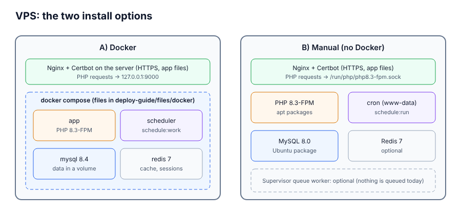
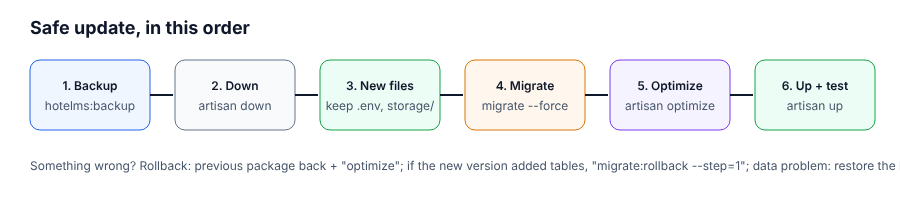

# HotelMS on a VPS (Ubuntu 24.04 LTS)

A VPS is your own small server. You get more speed and control than on shared hosting, and you are responsible
for its security. Follow the parts in order. Every step has **the exact command** and **what you should see**.
Type commands one line at a time. Things this guide cannot know about your provider are marked **CHECK**.

Ready-made files used below are in `deploy-guide/files/` (Nginx site, PHP settings, Docker files, deploy script,
backup script, systemd timer, Supervisor file).

## Your placeholders

| Placeholder | Meaning | Example (not real) |
|---|---|---|
| `<YOUR_DOMAIN>` | The address staff will open | `app.example.et` |
| `<SERVER_IP>` | The VPS's public IPv4 address (from your provider) | `203.0.113.10` |
| `<SSH_USER>` | Your own (non-root) user on the server | `hms` |
| `<YOUR_EMAIL>` | For Let's Encrypt expiry notices | `owner@example.et` |
| `<DB_PASSWORD>` | Password of the database user `hotelms` (long, random) | – |
| `<DB_ROOT_PASSWORD>` | MySQL root password (Docker option only) | – |
| `<APP_KEY>` | Made at the first install (starts with `base64:`) | – |
| `<BACKUP_KEY>` | Made at the first install by the deploy script (starts with `base64:`) – backups are encrypted with it | – |
| `<MAIL_HOST>` `<MAIL_PORT>` `<MAIL_USER>` `<MAIL_PASSWORD>` | Your outgoing mail server (provider's SMTP or a mail service) | `smtp.example.et`, `587` |
| `<SUPER_ADMIN_EMAIL>` | Your owner account | `owner@example.et` |
| `<OFFSITE_REMOTE>` | rclone remote for the second backup copy (in Ethiopia) | `hotelms-offsite:hotelms-backups` |
| `<YOUR_LAPTOP_USER>` | Your user in WSL / Linux on your laptop | `hashim` |

**Never put real passwords in this document, in a chat or in an email.** Keep them in a password manager.

## Contents

- Part 1 – Choose the VPS size
- Part 2 – First login and basic security
- Part 3 – Domain (DNS)
- Part 4 – Build the package on your laptop
- Part 5A – Install with **Docker** (option A) · Part 5B – **Manual** install (option B)
- Part 6 – The production `.env` (every line)
- Part 7 – HTTPS with Certbot
- Part 8 – The installable / offline app
- Part 9 – Updating with almost no downtime
- Part 10 – Daily backups off the server, and restore
- Part 11 – Monitoring
- Part 12 – Rollback
- Troubleshooting · What was tested · Go-live checklist · First 24 hours · Security



**Which option?** **A) Docker** if you already know Docker (the project uses it for development). **B) Manual** if
you prefer plain Ubuntu packages – fewer moving parts, and it matches `docs/hosting.md` (2b). Both use the same
Nginx site, the same `.env`, the same deploy script. Choose one; do not mix them.

---

## Part 1 – Choose the VPS size

These are **estimates** (CHECK after the first month with Super Admin → System and `htop`). The basis: the project's
speed test with one big hotel (160 rooms, 15,000 bookings) answers the dashboard in about 0.2 s on the CI server.

| Hotels | CPU | RAM | Disk (SSD) | Notes |
|---|---|---|---|---|
| 1–2 | 1 vCPU | 2 GB | 25 GB | Manual option. Add 2 GB swap (Troubleshooting). Docker is possible but tight. |
| ~5 | 2 vCPU | 4 GB | 50 GB | Either option. Redis on. |
| 20+ | 4 vCPU | 8 GB | 100 GB+ | Watch disk (uploads + 30 days of backups). Later: database on its own server (CHECK). |

Always choose **Ubuntu 24.04 LTS (64-bit)**, a data centre **in Ethiopia** (data law), and SSD storage. Ask for
snapshots (a copy of the whole server) if the provider offers them.

---

## Part 2 – First login and basic security

### 2.1 First login

Your provider gives you `<SERVER_IP>` and a root password or lets you add an SSH key. On your laptop (WSL/Linux):

```sh
ssh root@<SERVER_IP>
```

The first time it asks *"Are you sure you want to continue connecting (yes/no)?"* → type `yes`.
**You should see:** a welcome text with `Ubuntu 24.04` and a prompt `root@…:~#`.

Update everything:

```sh
apt update && apt -y full-upgrade
reboot
```

Wait one minute, then `ssh root@<SERVER_IP>` again.

### 2.2 Your own user (do not work as root)

```sh
adduser <SSH_USER>
usermod -aG sudo <SSH_USER>
```

`adduser` asks for a password (keep it in your password manager) and some optional details (press Enter).

### 2.3 SSH keys (on your laptop)

Open a **new** terminal on your laptop:

```sh
ls ~/.ssh/id_ed25519.pub || ssh-keygen -t ed25519 -C "<YOUR_EMAIL>"
ssh-copy-id <SSH_USER>@<SERVER_IP>
ssh <SSH_USER>@<SERVER_IP>
```

**You should see:** you are logged in as `<SSH_USER>` without typing the server password (only your key's passphrase,
if you set one). Keep this window open while you do 2.4.

### 2.4 Turn off password logins and root login

On the server (as `<SSH_USER>`):

```sh
printf 'PasswordAuthentication no\nPermitRootLogin no\nKbdInteractiveAuthentication no\n' | sudo tee /etc/ssh/sshd_config.d/99-hotelms.conf
sudo sshd -t && sudo systemctl restart ssh
```

**You should see:** no output from `sshd -t` (= the settings are valid). **Test in a new laptop window** that
`ssh <SSH_USER>@<SERVER_IP>` still works before you close the old one. `ssh root@<SERVER_IP>` must now be refused.

### 2.5 Firewall (ufw)

```sh
sudo ufw allow OpenSSH
sudo ufw allow 80/tcp
sudo ufw allow 443/tcp
sudo ufw enable
sudo ufw status
```

Type `y` when asked. **You should see:** `Status: active` and three ALLOW lines (OpenSSH, 80, 443; also for v6).
Nothing else is open: MySQL, Redis and PHP stay private. (Docker note: ports Docker publishes are **not** filtered
by ufw – that is why the Docker files publish PHP only on `127.0.0.1` and MySQL/Redis not at all.)

### 2.6 fail2ban (blocks password guessers)

```sh
sudo apt install -y fail2ban
printf '[sshd]\nenabled = true\nmaxretry = 5\nbantime = 1h\n' | sudo tee /etc/fail2ban/jail.local
sudo systemctl enable --now fail2ban
sudo fail2ban-client status sshd
```

**You should see:** `Status for the jail: sshd` with `Currently banned: 0` (or more later).

### 2.7 Automatic security updates

```sh
sudo apt install -y unattended-upgrades
sudo dpkg-reconfigure -plow unattended-upgrades
```

Choose **Yes**. Security updates now install by themselves every day. Reboot once a month in a quiet hour
(`sudo reboot`) – or when `/var/run/reboot-required` exists.

### 2.8 Time zone

Keep the server on **UTC** (the default). HotelMS itself runs on UTC (`config/app.php`) and shows hotel times in
each hotel's own time zone. Check: `timedatectl` → `Time zone: Etc/UTC`.

---

## Part 3 – Domain (DNS)

At the company where your domain is registered (or its DNS host), add:

| Type | Name | Value | TTL |
|---|---|---|---|
| A | `app` (the part of `<YOUR_DOMAIN>` before the main domain; `@` if `<YOUR_DOMAIN>` is the main domain) | `<SERVER_IP>` | 3600 |
| AAAA | same | the server's IPv6 address (only if it has one – CHECK) | 3600 |

Check from your laptop (may take minutes to hours):

```sh
getent hosts <YOUR_DOMAIN>
```

**You should see:** `<SERVER_IP>  <YOUR_DOMAIN>`.

---

## Part 4 – Build the package on your laptop

On your laptop (Windows: open **Ubuntu** / WSL). You need PHP 8.3, Composer, Node 22, zip, rsync and git.

```sh
php -v && composer --version && node -v
```

**You should see:** `PHP 8.3…`, `Composer version 2…`, `v22…`. If something is missing (Ubuntu 24.04 in WSL – CHECK
with `lsb_release -a`):

```sh
sudo apt update
sudo apt install -y php8.3-cli php8.3-mbstring php8.3-xml php8.3-zip php8.3-intl php8.3-bcmath php8.3-curl php8.3-mysql composer zip unzip rsync git
curl -fsSL https://deb.nodesource.com/setup_22.x | sudo -E bash -    # Node 22 (CHECK nodejs.org for other ways)
sudo apt install -y nodejs
```

Build from a **fresh copy** of `main` (then you know exactly which version goes online; the package script leaves your
local `.env`, uploads, logs and caches out either way):

```sh
cd ~
rm -rf hotelms-release
git clone https://github.com/kulmiss/hotelms.git hotelms-release
cd hotelms-release
git checkout main
./deploy/package.sh
```

**You should see**, ending without a red `ERROR`:

```
1/4 Web app
2/4 API
   Developer docs (Super Admin → Developer docs; not public)
3/4 Web app into public/ (as app.html, so / opens the app and /api stays Laravel)
4/4 Zip
Done: build/hotelms.zip – see docs/hosting.md
```

**Check the package:**

```sh
ls build/hotelms/public/guide | wc -l
ls build/hotelms/storage/app/private
```

**You should see:** `15` (the staff-guide pictures) and nothing for the second line (no uploads from your computer).

**Copy the package and the guide's server files to the server:**

```sh
scp build/hotelms.zip <SSH_USER>@<SERVER_IP>:~/
scp -r deploy-guide/files <SSH_USER>@<SERVER_IP>:~/hotelms-files
```

(`deploy-guide/` is in the repository on the branch where this guide lives; if your `main` does not have it yet, copy
the folder from that branch.)

---

## Part 5A – Install with Docker (option A)

Nginx and Certbot run on the server itself; PHP, the scheduler, MySQL and Redis run in Docker
(`files/docker/docker-compose.prod.yml`). This keeps the visitors' real IP address and the HTTPS flag without
any change to the app (sign-in limits count per IP address).

### 5A.1 Install Docker Engine

From Docker's own instructions for Ubuntu (CHECK docs.docker.com → "Install Docker Engine on Ubuntu" for changes):

```sh
sudo apt install -y ca-certificates curl
sudo install -m 0755 -d /etc/apt/keyrings
sudo curl -fsSL https://download.docker.com/linux/ubuntu/gpg -o /etc/apt/keyrings/docker.asc
sudo chmod a+r /etc/apt/keyrings/docker.asc
echo "deb [arch=$(dpkg --print-architecture) signed-by=/etc/apt/keyrings/docker.asc] https://download.docker.com/linux/ubuntu $(. /etc/os-release && echo "$VERSION_CODENAME") stable" | sudo tee /etc/apt/sources.list.d/docker.list
sudo apt update
sudo apt install -y docker-ce docker-ce-cli containerd.io docker-buildx-plugin docker-compose-plugin
sudo docker run --rm hello-world
```

**You should see:** `Hello from Docker!`.

### 5A.2 Nginx, Certbot and folders on the server

```sh
sudo apt install -y nginx certbot python3-certbot-nginx unzip
sudo mkdir -p /var/www /var/backups/hotelms /opt/hotelms-docker
sudo chown www-data:www-data /var/backups/hotelms
sudo cp ~/hotelms-files/docker/* /opt/hotelms-docker/
sudo cp ~/hotelms-files/scripts/deploy.sh /opt/hotelms-docker/deploy.sh
sudo chmod +x /opt/hotelms-docker/deploy.sh
ls /opt/hotelms-docker
```

**You should see:** `99-hotelms.ini  db.env.example  deploy.sh  docker-compose.prod.yml  Dockerfile`.

### 5A.3 Database passwords for Docker

```sh
cd /opt/hotelms-docker
sudo cp db.env.example db.env
sudo nano db.env
```

Replace `<DB_PASSWORD>` and `<DB_ROOT_PASSWORD>` with two different long random passwords (`openssl rand -base64 24`
makes one). Save: **Ctrl+O**, **Enter**, **Ctrl+X**. Then: `sudo chmod 600 db.env`.

### 5A.4 Start the database, Redis and PHP (not the scheduler yet)

```sh
cd /opt/hotelms-docker
sudo docker compose -f docker-compose.prod.yml up -d --build mysql redis app
sudo docker compose -f docker-compose.prod.yml ps
```

**You should see** (after a minute): `hotelms-app-1` running, `hotelms-mysql-1` running `(healthy)`,
`hotelms-redis-1` running, and `127.0.0.1:9000->9000/tcp` next to `app`.
*Why not the scheduler yet:* it needs the app files, which the next step puts in place.

### 5A.5 First install with the deploy script

```sh
sudo HOTELMS_MODE=docker /opt/hotelms-docker/deploy.sh ~/hotelms.zip
```

The first run stops with: *"First install: /var/www/shared/.env was created from .env.production.example. Fill it
in …"*. Fill it in now – **Part 6** explains every line; for Docker use the **Docker column**:

```sh
sudo nano /var/www/shared/.env
```

Then run the same command again:

```sh
sudo HOTELMS_MODE=docker /opt/hotelms-docker/deploy.sh ~/hotelms.zip
```

**You should see** the steps `1/8` … `8/8`, among them `INFO  Application key set successfully.`, the migrations
ending with `create_idempotency_keys_table … DONE`, `Super Admin created: <SUPER_ADMIN_EMAIL> / temporary password: …`
(**write the password down now**), the `storage:link` line, the four `… DONE` lines of `optimize`, and at the end
`Done. Version in use: <date-time>`. `db:seed` also builds the demo hotel, so it can take a few minutes.

Copy the `APP_KEY=` and `BACKUP_KEY=` lines to your password manager: `sudo grep -E '^(APP|BACKUP)_KEY=' /var/www/shared/.env`.

### 5A.6 Start the scheduler

```sh
cd /opt/hotelms-docker
sudo docker compose -f docker-compose.prod.yml up -d scheduler
sudo docker compose -f docker-compose.prod.yml logs --tail=20 scheduler
```

**You should see** within a minute lines like `Running ['artisan' reservations:expire] … DONE`. The scheduler service
replaces the cron line (like the project's development setup).

### 5A.7 Nginx site (Docker)

```sh
sudo cp ~/hotelms-files/nginx/hotelms.conf /etc/nginx/sites-available/hotelms
sudo sed -i 's/<YOUR_DOMAIN>/app.example.et/' /etc/nginx/sites-available/hotelms   # put YOUR domain here
sudo sed -i 's#^\(\s*\)fastcgi_pass unix:/run/php/php8.3-fpm.sock;#\1\# fastcgi_pass unix:/run/php/php8.3-fpm.sock;#; s#^\(\s*\)\# fastcgi_pass 127.0.0.1:9000;#\1fastcgi_pass 127.0.0.1:9000;#' /etc/nginx/sites-available/hotelms
grep -n "fastcgi_pass\|server_name" /etc/nginx/sites-available/hotelms
sudo ln -s /etc/nginx/sites-available/hotelms /etc/nginx/sites-enabled/hotelms
sudo rm -f /etc/nginx/sites-enabled/default
sudo nginx -t && sudo systemctl reload nginx
```

**You should see:** `server_name <your domain>;`, the line `fastcgi_pass 127.0.0.1:9000;` **without** `#` in front
(and the socket line with `#`), then `syntax is ok` / `test is successful`.

Continue with **Part 7 (HTTPS)**.

### 5A.8 Running artisan commands (Docker)

Every `php artisan …` in this guide becomes:

```sh
cd /opt/hotelms-docker
sudo docker compose -f docker-compose.prod.yml exec -u www-data -w /var/www/hotelms app php artisan <command>
```

Tip: `alias hms-artisan='sudo docker compose -f /opt/hotelms-docker/docker-compose.prod.yml exec -u www-data -w /var/www/hotelms app php artisan'`
(add it to `~/.bashrc`), then `hms-artisan about`.

---

## Part 5B – Manual install (option B)

### 5B.1 Packages (exact versions from Ubuntu 24.04)

From `docs/hosting.md` (2b), plus the CLI package and Certbot:

```sh
sudo apt install -y nginx mysql-server redis-server unzip certbot python3-certbot-nginx \
  php8.3-fpm php8.3-cli php8.3-mysql php8.3-bcmath php8.3-mbstring php8.3-xml php8.3-zip php8.3-intl \
  php8.3-gd php8.3-curl php8.3-opcache php8.3-redis
php -v
php -m | grep -E -i "bcmath|intl|mbstring|pdo_mysql|zip|zlib|redis|opcache"
```

**You should see:** `PHP 8.3.x (cli)` and each extension name once (`Zend OPcache` for opcache).
Ubuntu 24.04 installs **MySQL 8.0** (supported: "MySQL 8") and **Redis 7** (CHECK the exact minor versions with
`mysql --version` and `redis-server --version`).

### 5B.2 PHP settings

```sh
sudo cp ~/hotelms-files/php/99-hotelms.ini /etc/php/8.3/fpm/conf.d/99-hotelms.ini
sudo cp ~/hotelms-files/php/99-hotelms.ini /etc/php/8.3/cli/conf.d/99-hotelms.ini
sudo systemctl restart php8.3-fpm
php -i | grep -E "^upload_max_filesize|^post_max_size|^memory_limit"
```

**You should see:** `upload_max_filesize => 9M`, `post_max_size => 10M`, `memory_limit => 256M`.
(Uploads may be 8 MB; PHP's default is 2 MB.)

### 5B.3 Database and user

```sh
sudo mysql
```

At the `mysql>` prompt (replace `<DB_PASSWORD>`, keep the quotes):

```sql
CREATE DATABASE hotelms CHARACTER SET utf8mb4 COLLATE utf8mb4_unicode_ci;
CREATE USER 'hotelms'@'localhost' IDENTIFIED BY '<DB_PASSWORD>';
GRANT ALL PRIVILEGES ON hotelms.* TO 'hotelms'@'localhost';
FLUSH PRIVILEGES;
EXIT;
```

**You should see:** `Query OK` after each line. Test: `mysql -u hotelms -p hotelms -e "select 1"` → type the
password → a small table with `1`.

Redis needs nothing: Ubuntu's Redis listens only on the server itself (`127.0.0.1`). Check:
`redis-cli ping` → `PONG`.

### 5B.4 Folders, deploy script, first install

```sh
sudo mkdir -p /var/www /var/backups/hotelms
sudo chown www-data:www-data /var/backups/hotelms
sudo cp ~/hotelms-files/scripts/deploy.sh /usr/local/bin/hotelms-deploy
sudo chmod +x /usr/local/bin/hotelms-deploy
sudo hotelms-deploy ~/hotelms.zip
```

The first run stops with *"First install: /var/www/shared/.env was created … Fill it in …"*. Fill it in (**Part 6**,
**Manual column**):

```sh
sudo nano /var/www/shared/.env
sudo hotelms-deploy ~/hotelms.zip
```

**You should see** steps `1/8` … `8/8`: `Application key set successfully.`, migrations `… DONE`,
`Super Admin created: <SUPER_ADMIN_EMAIL> / temporary password: …` (**write it down now**), the storage link, the
`optimize` lines, `Done. Version in use: …`. Copy both keys: `sudo grep -E '^(APP|BACKUP)_KEY=' /var/www/shared/.env`.
*(This script was tested in a test folder: first install, update, a failed backup that stops safely, and rollback.)*

### 5B.5 Nginx site (manual)

```sh
sudo cp ~/hotelms-files/nginx/hotelms.conf /etc/nginx/sites-available/hotelms
sudo sed -i 's/<YOUR_DOMAIN>/app.example.et/' /etc/nginx/sites-available/hotelms   # put YOUR domain here
sudo ln -s /etc/nginx/sites-available/hotelms /etc/nginx/sites-enabled/hotelms
sudo rm -f /etc/nginx/sites-enabled/default
sudo nginx -t && sudo systemctl reload nginx
```

**You should see:** `syntax is ok` and `test is successful`. (The file already uses `unix:/run/php/php8.3-fpm.sock`.)

### 5B.6 The scheduler – cron (or a systemd timer)

**Cron** (from `docs/hosting.md`):

```sh
sudo crontab -u www-data -e
```

Choose `nano` if asked, add this line at the end, save (Ctrl+O, Enter, Ctrl+X):

```
* * * * * cd /var/www/hotelms && php artisan schedule:run >> /dev/null 2>&1
```

Check: `sudo crontab -u www-data -l` shows the line.

**Or a systemd timer instead** (not both):

```sh
sudo cp ~/hotelms-files/systemd/hotelms-scheduler.* /etc/systemd/system/
sudo systemctl daemon-reload
sudo systemctl enable --now hotelms-scheduler.timer
systemctl list-timers | grep hotelms
```

**You should see:** `hotelms-scheduler.timer` with the next run within a minute.

### 5B.7 Queue worker – optional

Not needed: the scheduler already runs `queue:work --stop-when-empty --max-time=50` every minute, and today the app
puts nothing on the queue. If a future version asks for a permanent worker:

```sh
sudo apt install -y supervisor
sudo cp ~/hotelms-files/supervisor/hotelms-worker.conf /etc/supervisor/conf.d/
sudo supervisorctl reread && sudo supervisorctl update && sudo supervisorctl status
```

**You should see:** `hotelms-worker RUNNING`. After each update: `sudo supervisorctl restart hotelms-worker`.

Continue with **Part 7 (HTTPS)**.

---

## Part 6 – The production `.env` (every line)

File: `/var/www/shared/.env` (shared by all versions; made from `backend/.env.production.example` by the deploy
script). Lines you may add are marked *(add)*.

| Line | Docker (A) | Manual (B) | Why |
|---|---|---|---|
| `APP_NAME` | `HotelMS` | `HotelMS` | Name in emails. Screen name/logo/colour: Super Admin → Branding. |
| `APP_ENV` | `production` | `production` | |
| `APP_KEY` | leave **empty** – the deploy script makes it once | same | **Never change it later.** Guest ID numbers, two-step secrets and backups depend on it. Keep a copy. |
| `APP_DEBUG` | `false` | `false` | `true` shows internals to anyone. Never on a live server. |
| `APP_URL` | `https://<YOUR_DOMAIN>` | same | Links in emails. |
| `FRONTEND_URL` | `https://<YOUR_DOMAIN>` | same | |
| `LOG_CHANNEL` | `daily` | `daily` | `storage/logs/laravel-YYYY-MM-DD.log`. |
| `LOG_LEVEL` | `warning` | `warning` | |
| `DB_CONNECTION` | `mysql` | `mysql` | |
| `DB_HOST` | `mysql` (the Docker service name) | `127.0.0.1` | |
| `DB_PORT` | `3306` | `3306` | |
| `DB_DATABASE` | `hotelms` | `hotelms` | Same as `MYSQL_DATABASE` in `db.env` (A) / 5B.3. |
| `DB_USERNAME` | `hotelms` | `hotelms` | |
| `DB_PASSWORD` | `<DB_PASSWORD>` (same as in `db.env`) | `<DB_PASSWORD>` | Use double quotes if it contains `#` or spaces. |
| `SESSION_DRIVER` | `redis` | `redis` (or `database`) | Redis is faster; `database` also works. |
| `SESSION_LIFETIME` | `480` | `480` | Minutes (8 hours). |
| `SESSION_SECURE_COOKIE` | `true` | `true` | HTTPS-only cookies. |
| `SESSION_DOMAIN` | `<YOUR_DOMAIN>` | same | Exactly the domain, no `https://`. |
| `SANCTUM_STATEFUL_DOMAINS` | `<YOUR_DOMAIN>` | same | Sign-in only from this domain. |
| `CACHE_STORE` | `redis` | `redis` (or `database`) | |
| `QUEUE_CONNECTION` | `redis` (or `database`) | `database` (or `redis`) | Run by the scheduler every minute. |
| `REDIS_HOST` *(add)* | `redis` | `127.0.0.1` | Needed when any driver above is `redis`. |
| `REDIS_PORT` *(add)* | `6379` | `6379` | |
| `REDIS_PASSWORD` *(add)* | `null` | `null` | Redis is not reachable from outside (A: internal Docker network; B: 127.0.0.1 only). |
| `MAIL_MAILER` | `smtp` | `smtp` | |
| `MAIL_HOST` | `<MAIL_HOST>` | same | Or set it later in Super Admin → Settings → Emails (replaces these lines). |
| `MAIL_PORT` | `<MAIL_PORT>` | same | `587` (STARTTLS) or `465` (SSL). |
| `MAIL_SCHEME` *(add, port 465 only)* | `smtps` | `smtps` | Leave out for 587. |
| `MAIL_USERNAME` / `MAIL_PASSWORD` | `<MAIL_USER>` / `<MAIL_PASSWORD>` | same | |
| `MAIL_FROM_ADDRESS` | `<MAIL_USER>` | same | |
| `MAIL_FROM_NAME` | `"${APP_NAME}"` | same | |
| `SUPER_ADMIN_EMAIL` | `<SUPER_ADMIN_EMAIL>` | same | Owner account made by `db:seed`. |
| `SUPER_ADMIN_PASSWORD` | **empty** | **empty** | A random temporary password is printed once at the first install. |
| `HOTELMS_TWO_FACTOR_ADMINS` | `true` | `true` | Two-step sign-in for the HotelMS team and Hotel Admins. |
| `TRUSTED_PROXIES` | **empty** | **empty** | Only if a proxy or CDN (e.g. Cloudflare) sits in front: its addresses. Empty = trust nobody, so nobody can fake their IP. |
| `BACKUP_PATH` | `/var/backups/hotelms` | `/var/backups/hotelms` | Docker mounts this folder into the containers. |
| `BACKUP_COPY_PATH` | empty (Part 10 copies off-server) | same | Or a second mounted disk. |
| `BACKUP_KEEP_DAYS` | `30` | `30` | |
| `BACKUP_KEY` | leave **empty** – the deploy script makes it once | same | Backups are encrypted with it; a live server makes no backup without it. Keep a copy; never lose it. |

Protect it: `sudo chown www-data:www-data /var/www/shared/.env && sudo chmod 640 /var/www/shared/.env`
(the deploy script does this at the first install). After any change: `php artisan optimize`
(Docker: Part 5A.8) – settings are cached.

---

## Part 7 – HTTPS with Certbot

```sh
sudo certbot --nginx -d <YOUR_DOMAIN> -m <YOUR_EMAIL> --agree-tos --redirect
```

**You should see:** `Successfully deployed certificate for <YOUR_DOMAIN>` and `Congratulations! You have successfully
enabled HTTPS`. Certbot adds the 443 (HTTPS) part to `/etc/nginx/sites-available/hotelms` and the redirect from
`http://` to `https://`.

Automatic renewal is installed by the Ubuntu package (a systemd timer). Test it:

```sh
sudo certbot renew --dry-run
systemctl list-timers | grep certbot
```

**You should see:** `Congratulations, all simulated renewals succeeded` and a `certbot.timer` line.

Now open `https://<YOUR_DOMAIN>/` → **You should see** the HotelMS sign-in page. Sign in with
`<SUPER_ADMIN_EMAIL>` and the temporary password, choose your own password, set up two-step sign-in, then open
**Super Admin → System**: Database, Cache (`redis` or `database`), Scheduler, Jobs, Backups, Disk – all green
(Backups after the first backup; make one now: `php artisan hotelms:backup`).

---

## Part 8 – The installable / offline app

Staff can "install" HotelMS on a phone or computer, and it keeps a copy of the app for poor connections.
What it needs, and where it comes from:

| Needs | Done by |
|---|---|
| HTTPS | Part 7 (browsers allow offline/installable apps only on HTTPS). |
| `sw.js` at the top of the site, never cached | `files/nginx/hotelms.conf` (`location = /sw.js` → `Cache-Control: no-cache`). |
| `app.html` never cached | same file (`location = /app.html`). Otherwise staff keep an old version. |
| Built files cached for a year | `location /assets/` (the file names change with every build). |
| The app manifest | Sent by Laravel at `/api/v1/branding/manifest` (name, colour, icons from Super Admin → Branding). |
| Icons | `icon-192.png`, `icon-512.png`, `apple-touch-icon.png` in `public/` (copied by `deploy/package.sh`). |

Check in Chrome on a computer: open `https://<YOUR_DOMAIN>/` → **F12** → **Application** → **Manifest** (no red
errors) and **Service workers** (`sw.js` "activated and is running"). Check the headers from the server:

```sh
curl -sI https://<YOUR_DOMAIN>/sw.js | grep -i cache-control
curl -sI https://<YOUR_DOMAIN>/app.html | grep -i cache-control
```

**You should see:** `cache-control: no-cache` for both. After an update, staff see "A new version is ready"; the app
also checks every 30 minutes by itself.

---

## Part 9 – Updating with almost no downtime



The deploy script (`files/scripts/deploy.sh`) does the whole update in the right order: **backup → maintenance mode
→ switch to the new version → migrate → storage link → optimize → reload PHP → online**. The app is offline only
for the migration and cache steps (usually seconds). Each version stays in its own folder in `/var/www/releases/`
(the newest 5 are kept), so going back is one command (Part 12).

1. On your laptop: build the new package (Part 4) and copy it: `scp build/hotelms.zip <SSH_USER>@<SERVER_IP>:~/`
2. On the server:

   **Manual (B):** `sudo hotelms-deploy ~/hotelms.zip`

   **Docker (A):** `sudo HOTELMS_MODE=docker /opt/hotelms-docker/deploy.sh ~/hotelms.zip`

3. **You should see:** `3/8 Backup first` with `Backup /var/backups/hotelms/daily/….sql.gz.enc: …, encrypted`, `Application is now in
   maintenance mode.`, the migrations (`Nothing to migrate.` or new `DONE` lines), `Application is now live.` and
   `Done. Version in use: <date-time>`.
   If the backup fails, the script **stops before changing anything** ("The backup failed – nothing was changed").
4. Test: Super Admin → System all green; a test booking or payment in the **demo** hotel.
5. **Docker only, when the Dockerfile changed** (rare – new PHP extension): `cd /opt/hotelms-docker && sudo docker
   compose -f docker-compose.prod.yml up -d --build`.
6. **Supervisor worker only** (if you set it up): `sudo supervisorctl restart hotelms-worker`.

*When the release notes say "migrate required" (new tables), the script's migrate step does it.*

---

## Part 10 – Daily backups off the server, and restore

### 10.1 What the app does by itself

- Full backup every night **01:15 UTC**, small one every hour at `:40`, in `BACKUP_PATH` (`/var/backups/hotelms`),
  kept 30 days / 48 hours. Uploaded files (payment proofs, **encrypted** guest ID photos) are mirrored every night to
  `/var/backups/hotelms/files`. On the 1st of each month the newest backup is checked; problems are emailed to the
  HotelMS owners.
- By hand: `php artisan hotelms:backup` · check: `php artisan hotelms:backup --check` → `OK: … tables in …`.
- Every backup is **encrypted** with `BACKUP_KEY` (`….sql.gz.enc`; uploaded-file copies `….enc`), so the off-server
  copy below holds only encrypted files. **Restoring needs both keys:** `BACKUP_KEY` and `APP_KEY`.

### 10.2 Copy them off the server every night (rclone)

A copy on the same server is lost with the server. Choose a storage place **in Ethiopia** (data law – CHECK with your
provider: S3-compatible storage, another server with SFTP, …).

```sh
sudo apt install -y rclone
sudo rclone config
```

In `rclone config`: `n` (new remote) → name **`hotelms-offsite`** → choose your storage type (e.g. `sftp` or `s3`) →
answer its questions (host, user, key or password – from your storage provider) → `q`. Test:

```sh
sudo rclone lsd hotelms-offsite:
sudo cp ~/hotelms-files/scripts/offsite-backup.sh /usr/local/bin/hotelms-offsite-backup.sh
sudo chmod +x /usr/local/bin/hotelms-offsite-backup.sh
sudo HOTELMS_REMOTE=hotelms-offsite:hotelms-backups /usr/local/bin/hotelms-offsite-backup.sh
```

**You should see:** `… copying /var/backups/hotelms to hotelms-offsite:hotelms-backups` and `… done`.
Make it run every night after the app's backup:

```sh
sudo crontab -e
```

Add (one line; replace the remote if you named it differently):

```
0 2 * * * HOTELMS_REMOTE=hotelms-offsite:hotelms-backups /usr/local/bin/hotelms-offsite-backup.sh >> /var/log/hotelms-offsite.log 2>&1
```

Check the next morning: `sudo tail /var/log/hotelms-offsite.log`.

### 10.3 Restore (replaces ALL data)

```sh
php artisan down
php artisan hotelms:backup --restore=/var/backups/hotelms/daily/<BACKUP_FILE>
php artisan up
```

It asks *"Replace ALL current data with …?"* → `yes`. **You should see:** `… statements restored.`
(Docker: use the commands of Part 5A.8; the path is the same inside the container.)

Uploaded files: `sudo rsync -a /var/backups/hotelms/files/ /var/www/shared/storage/app/private/ && sudo chown -R
www-data:www-data /var/www/shared/storage/app/private`. On a **new** server: install as in Part 5, put the **same**
`APP_KEY` in `.env` before the first start, restore the database and the files, `php artisan optimize`.

---

## Part 11 – Monitoring

| What | How | Good |
|---|---|---|
| **Super Admin → System** | Open it daily the first week, then weekly | all green |
| Super Admin → Watchdog | Same | no red warnings |
| App log | `sudo tail -n 50 /var/www/shared/storage/logs/laravel-$(date -u +%F).log` | empty or a few warnings |
| Nginx errors | `sudo tail -n 50 /var/log/nginx/error.log` | nothing new |
| PHP (B) | `sudo journalctl -u php8.3-fpm --since today` | no errors |
| Containers (A) | `sudo docker compose -f /opt/hotelms-docker/docker-compose.prod.yml ps` and `… logs --tail=50 app` | all running |
| Disk | `df -h /` | under 80 % used (the app warns under 500 MB free) |
| Memory | `free -h` | "available" > 300 MB |
| Uptime from outside | A free uptime monitor that opens `https://<YOUR_DOMAIN>/up` every 5 minutes and emails you if it fails (CHECK which service you trust; it sees no guest data) | 200 OK |
| HTTPS expiry | `sudo certbot certificates` | > 30 days left (renewal is automatic) |

`/up` is Laravel's built-in health address (`bootstrap/app.php`); `/api/v1/health` also exists.

---

## Part 12 – Rollback

1. **If the new version added tables** ("migrate required"), undo that first, **while the new version is still in
   use**: `php artisan migrate:rollback --step=1 --force` (CI checks every migration can go back). Unsure? Skip it and
   use step 3 if needed.
2. **Previous version back:**

   **Manual (B):** `sudo hotelms-deploy --rollback`

   **Docker (A):** `sudo HOTELMS_MODE=docker /opt/hotelms-docker/deploy.sh --rollback`

   **You should see:** `Going back from <new> to <previous>` and `Done. Version in use: <previous>`.
   (Tested in a test folder.)
3. **Data problem:** restore the backup that the deploy script made just before the update (Part 10.3; the file name
   is in the script's output, step `3/8`).

---

## Troubleshooting

| You see | Likely cause | Check / fix |
|---|---|---|
| **502 Bad Gateway** | Nginx cannot reach PHP. | B: `sudo systemctl status php8.3-fpm` → `sudo systemctl restart php8.3-fpm`; the socket must be `/run/php/php8.3-fpm.sock`. A: `docker compose … ps` – is `app` running? `docker compose … logs app`. The Nginx line must be `fastcgi_pass 127.0.0.1:9000;` (5A.7). |
| **504 Gateway Timeout** | A very slow request. | `storage/logs`; Super Admin → System; more CPU/RAM. |
| **500** error | A PHP error. | Read the app log (Part 11). Never set `APP_DEBUG=true` on the live site. |
| Log: `Call to undefined function App\Support\bcadd()` | `bcmath` missing. | B: `sudo apt install php8.3-bcmath && sudo systemctl restart php8.3-fpm`. A: the Dockerfile includes it – rebuild. |
| Log: `could not find driver` | `pdo_mysql` missing. | B: `php8.3-mysql`. |
| Log: `Permission denied` on `storage/…` | Files not owned by `www-data`. | `sudo chown -R www-data:www-data /var/www/shared/storage /var/www/releases && sudo chmod -R ug+rwX /var/www/shared/storage`. |
| Log: `Connection refused` (Redis) | Redis down or wrong host. | B: `redis-cli ping`; A: `REDIS_HOST=redis`. Or switch the drivers to `database`. |
| Log: `SQLSTATE[HY000] [1045] Access denied` | Wrong DB password / user. | `.env` vs 5B.3 / `db.env`. Then `php artisan optimize`. |
| Log: `SQLSTATE[HY000] [2002]` | DB not reachable. | B: `sudo systemctl status mysql`; A: `DB_HOST=mysql`, `docker compose … ps` (healthy). |
| Signed out at once / "419" / "CSRF token mismatch" | Domain settings or http instead of https. | `SESSION_DOMAIN`, `SANCTUM_STATEFUL_DOMAINS` = `<YOUR_DOMAIN>`, Part 7. `php artisan optimize`. |
| **413 Request Entity Too Large** | Upload over the Nginx limit. | `client_max_body_size 10m;` in the site, `sudo systemctl reload nginx`; PHP limits (5B.2). |
| Super Admin → System: Jobs red / waiting jobs pile up ("queue stuck") | The scheduler does not run, or a job keeps failing. | Fix the scheduler (next line). Failed jobs: `php artisan queue:failed`, after fixing the cause `php artisan queue:retry all`. |
| *"The cron job has never run…"* / *"The cron job stopped running."* | Scheduler not running. | B cron: `sudo crontab -u www-data -l`; test `sudo -u www-data php /var/www/hotelms/artisan schedule:run` (prints `Running [...] DONE`). B timer: `systemctl status hotelms-scheduler.timer`. A: `docker compose … ps scheduler`, `… logs scheduler`. |
| Browser: "Your connection is not private" | Certificate missing/expired, or DNS points elsewhere. | `sudo certbot certificates`; `getent hosts <YOUR_DOMAIN>`; `sudo certbot renew`; ports 80/443 open (`sudo ufw status`). |
| Certbot: *"Timeout during connect"* / *"unauthorized"* | DNS not ready or port 80 blocked. | Part 3; `sudo ufw allow 80/tcp`; provider firewall (CHECK). |
| **Out of memory** – PHP or MySQL killed, random 502s | Too little RAM. | `free -h`; `sudo dmesg -T | grep -i -E "killed process|out of memory"`. Add swap (below) or a bigger VPS. |
| Pictures missing in Help → How to use | The package is older than 9 Nov 2026 (before the fix in `deploy/package.sh`). | Build a new package (Part 4), deploy again. |
| Uploaded logo does not show | `public/storage` link. | `php artisan storage:link` (the deploy script does it). |

**Add 2 GB swap** (helps small servers survive memory peaks):

```sh
sudo fallocate -l 2G /swapfile && sudo chmod 600 /swapfile && sudo mkswap /swapfile && sudo swapon /swapfile
echo '/swapfile none swap sw 0 0' | sudo tee -a /etc/fstab
free -h
```

**You should see:** a `Swap:` line with `2.0Gi`.

---

## What was tested

Tested in the guide's workspace (Ubuntu 24.04, PHP 8.3.6), on a copy of the real project:

- `php artisan key:generate`, `key:generate --show` (works without a `.env`), `migrate --force` (all migrations,
  ending with `create_idempotency_keys_table`), `storage:link`, `optimize`, `schedule:list`, `schedule:run`,
  `down` / `up`, `about` – the "You should see" texts above come from these runs.
- Redis as cache/session/queue driver (`CACHE_STORE=redis` etc.) – works.
- `files/scripts/deploy.sh` in **manual mode** in a test folder: first install (creates `.env` and stops), first
  install with `.env` (key, migrations, link, caches), an update (backup → down → switch → migrate → optimize → up),
  an update whose backup fails (stops, nothing changed, leftover removed), and `--rollback`.

**Not tested** (and why):

- A clean Ubuntu 24.04 VM or container: the workspace has no Docker daemon and cannot reach Ubuntu's package
  servers. So the `apt install` lines, MySQL 8.0, Nginx, Certbot, ufw, fail2ban, Supervisor and the systemd timer were
  **not** run. They follow `docs/hosting.md` and the standard Ubuntu packages.
- **Option A (Docker)** – the Dockerfile and compose file were written from the project's development Docker setup
  but never built or started.
- `deploy.sh` in Docker mode, and the PHP-FPM reload step.
- `php artisan db:seed` to the end (stops without `bcmath`, which the workspace lacks – that is the same error shown in
  Troubleshooting) and `hotelms:backup` (needs MySQL; it correctly said "Backups need MySQL." on SQLite).
- The Nginx file (`nginx -t` not available) – based on `docs/hosting.md` with a few additions.
- `offsite-backup.sh` (needs rclone and a storage account).

**Do a test install first** on a cheap VPS or a staging subdomain before the real launch.

---

## Go-live checklist

From `docs/hosting.md` – at the first launch and at every big update.

1. **Backup first:** `php artisan hotelms:backup`, then `php artisan hotelms:backup --check`. `BACKUP_KEY` is set (System → Backups: "encrypted"). Keep copies of `APP_KEY` and `BACKUP_KEY`.
   (The deploy script makes the backup itself for updates.)
2. **New code on the server** (Part 5 or 9), then **migrate:** `php artisan migrate --force`, then
   `php artisan optimize` (the deploy script does both).
3. **Scheduler runs every minute:** cron / systemd timer (B) or the `scheduler` container (A). Super Admin → System:
   Scheduler green.
4. **LICENSE:** the owner's name / company and email are filled in (no `[OWNER …]` placeholders) – before the final
   release goes to `main`.
5. **What's new:** publish the note for staff (Super Admin → Releases; draft in `docs/drafts/`).
6. **Code:** the final PR `ui/shadcn-admin → main` is merged; the package is built from `main` (Part 4).
7. **Smoke test:** sign in as each role (Hotel Admin, Branch Manager, Receptionist, Housekeeping, Accountant,
   Restaurant / Bar) on a phone and a computer; take a test payment in the **demo** hotel.
8. **Dashboards:** open the dashboard as Hotel Admin (charts show, data in about 1 s) and as Receptionist (no money
   anywhere on it). Super Admin → Command center shows real hotels only (the demo is left out).
9. **Rollback plan ready:** `deploy.sh --rollback` (Part 12); the backup file name from the deploy output.

## First 24 hours after go-live

| When | Look at | Good | If not |
|---|---|---|---|
| Right after | Super Admin → System; `curl -sI https://<YOUR_DOMAIN>/up` | all green; `HTTP/2 200` | Troubleshooting |
| After 1 hour | Backups: a small backup at `:40` | a new `….sql.gz.enc` in `/var/backups/hotelms/hourly/` (`sudo ls -l /var/backups/hotelms/hourly`) | scheduler |
| After 1 hour | App log, Nginx error log (Part 11) | quiet | read the last lines |
| First check-ins | Ask reception about speed and errors; `htop` | pages in about 1 s; CPU not stuck at 100 % | bigger VPS, Redis on |
| Evening | `free -h`, `df -h /` | memory available, disk < 80 % | swap / more disk |
| Evening | Super Admin → Watchdog | no red warnings | open each |
| Next morning | Full backup from **01:15 UTC** (04:15 Addis) and the off-server copy (`/var/log/hotelms-offsite.log`) | both present | Part 10 |
| Next morning | `sudo fail2ban-client status sshd`, `sudo ufw status` | fail2ban active, only 22/80/443 open | Part 2 |

## Security

- **Never** commit `.env` or `db.env` to Git, never send them by email or chat. `deploy/package.sh` leaves `.env` out.
- `APP_DEBUG=false`, always.
- Strong random passwords (`openssl rand -base64 24`) for MySQL users, different from every other password.
- **Keep a safe copy of `APP_KEY`** (password manager + one more safe place). Without it, backups and guest ID data
  cannot be read.
- Only `/var/www/hotelms/public` is served. `.env`, `storage/`, backups and the releases are outside it; hidden files
  (`.env`, `.git`) are refused by the Nginx site; uploaded logos are served with a strict "pictures only" header.
- SSH: keys only, no root login, fail2ban, ufw (Part 2). Automatic security updates on.
- Docker: PHP published only on `127.0.0.1`, MySQL and Redis not published at all.
- `.env` 640 owned by `www-data`; `db.env` 600; never `chmod 777`.
- Remove `SUPER_ADMIN_PASSWORD` from `.env` if you ever put one there, after the first sign-in.
- Keep the Super Admin email account and your SSH key safe – together they can reach everything.
