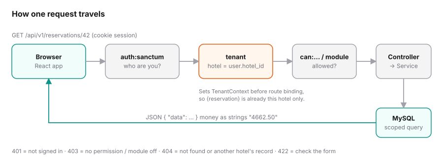
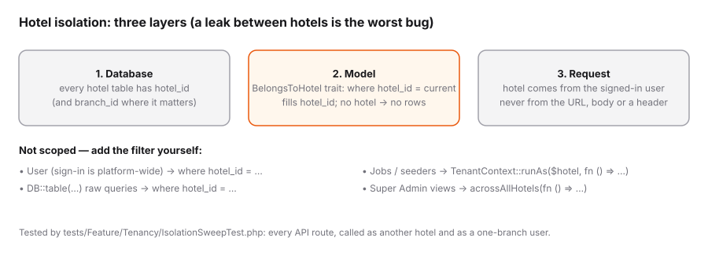

# Architecture

## The pieces

```
Browser (React app)  ──HTTPS, cookie session──►  Laravel API (/api/v1, JSON)  ──►  MySQL
        ▲                                                │
        │ polls every 30 s (no WebSockets)               ├─ cron: php artisan schedule:run (every minute)
        └────────────────────────────────────────────────┘     reports, automations, backups, watchdog, Telegram
```

| Folder | What | Stack |
|---|---|---|
| `backend/` | REST API, business rules, scheduled jobs | Laravel 13, PHP 8.3, MySQL 8.4, Sanctum (cookie sessions) |
| `frontend/` | The web app for hotel staff and the Super Admin team | React 19, TypeScript, Vite, Tailwind v4, React Router, TanStack Query, react-i18next |
| `deploy/` | `package.sh` builds one zip for shared hosting or a VPS | |
| `docs/` | This documentation | |

In production, **one domain** serves both: `public/app.html` (the React build) and `/api/...` (Laravel).
See [hosting.md](hosting.md).



### Hosting limits shape the code (owner decision)
The same code must run on **cPanel shared hosting** and on a **VPS**:
- No always-on worker: background work runs from one cron line (`schedule:run` every minute); queued jobs run with `--stop-when-empty`.
- No WebSocket server: live screens **poll** (room board every 30 s).
- Redis is optional: cache, sessions and queues work with the **database** drivers.
- Docker is for development only.

## Two kinds of users

| Who | `users` row | Sees |
|---|---|---|
| **Hotel staff** (Hotel Admin, Branch Manager, Receptionist, Housekeeping, Accountant, Restaurant / Bar, custom roles) | `hotel_id` set, `role_id` set, branches in `branch_user` | Their hotel only, their branches only, what their role allows |
| **Super Admin team** (HotelMS company: Owner, Support, Sales, Finance, Tech) | `is_super_admin = true`, `hotel_id = null`, `platform_role` | `/admin/...` screens: all hotels, billing, switches, support, watchdog |

A Super Admin can **"log in as hotel"** (impersonation) for support, with a required reason. It is logged
(`impersonation_logs`, activity log) and some actions are blocked during it (`not.impersonating` middleware).

## Multi-hotel isolation (the most important rule)

A data leak between hotels is the worst possible bug. Isolation is enforced in **three layers**:



1. **Every hotel-owned table has `hotel_id`** (and `branch_id` where it matters).
2. **Models use the `BelongsToHotel` trait** (`app/Models/Concerns/BelongsToHotel.php`):
   - adds a global scope `where hotel_id = <current hotel>`;
   - fills `hotel_id` on create;
   - **fails closed**: with no current hotel, queries return nothing (`where 1 = 0`).
3. **The current hotel comes from the signed-in user, never from the request.** The `tenant`
   middleware (`SetTenantContext`) sets `TenantContext` from `auth()->user()->hotel_id`. It runs
   **before** route-model binding, so `{reservation}` in a URL is already scoped.

Other rules:
- `User` is **not** scoped (sign-in is platform-wide): always filter staff lists by `hotel_id`.
- Raw `DB::table(...)` queries are **not** scoped: always add `->where('hotel_id', …)`.
- Branch access: `$user->accessibleBranches()`; controllers check the branch of every record.
- Jobs and seeders: `TenantContext::runAs($hotel, fn () => …)`. Super Admin platform views: `acrossAllHotels(fn () => …)`.
- Tests: `tests/Feature/Tenancy/IsolationSweepTest.php` calls **every API route** as another hotel and as a
  one-branch user; `HotelIsolationTest` and others check the scope. Add your new route's records there if they are special.

## Permissions

- **Hotel permissions**: `config/permissions.php` – each permission lists the default roles that have it.
  Hotel Admin has everything and is locked. Roles are per hotel (`roles`, `role_permissions`); a hotel can
  make its own roles. Routes use `->middleware('permission:x.y')` (any of a comma list);
  inside code: `$user->hasPermission('x.y')`. The frontend gets `me.permissions` and uses `useCan()`.
- A person can only give roles/permissions/discounts **they have themselves** (no escalation).
- **Platform permissions** (Super Admin team): defaults in `config/hotelms.php` (`platform_roles`, `platform_permissions`), read by `app/Services/PlatformPermissions.php`; middleware `platform:x.y`.
  The Owner has everything; the Owner can change what each team role may do (Team page).
- **Optional modules** (cashier close, housekeeping, shifts, attendance): plan decides availability,
  Hotel Admin turns them on (`hotel_modules`); routes use `module:<key>`.
- **Switches** (`config/switches.php`): Super Admin turns features on/off for everyone, a plan or one hotel
  (`feature_switches`); routes use `switch:<key>`, code uses `Switches::on($hotel, $key)`.

## Money

- Database: `decimal(14,2)` + a currency code column. Exchange rates `decimal(14,6)`.
- PHP: **never floats**. Use `App\Support\Money` (bcmath strings: `add`, `sub`, `mul`, `percentOf`, `round`, `sum`, `compare`).
- JSON: money is a **string** (`"4662.50"`).
- Frontend: `lib/decimal.ts` (`addMoney`, `isPositive`, `isNegative`… using BigInt cents); display with `money()` from `lib/format.ts`.
- Every payment stores `amount`, `currency`, `exchange_rate`, `amount_in_base` (the hotel's main currency).

## Time

- The database stores **UTC**. Each hotel has a `timezone` (default `Africa/Addis_Ababa`).
- `App\Support\HotelClock`: `now($hotel)`, `local($utc, $hotel)`, `iso(...)` (ISO 8601 with offset, sent to the app), `parse(...)`.
- Dates of nights (`reservation_room_rates.date`, `invoice_items.service_date`) are **hotel-local dates**.
- A night's booking: check-in at the branch's check-in time, check-out at its check-out time.

## Languages

- Every UI string goes through `t()`; English text is in `frontend/src/i18n/locales/en.json`
  (staff guides in `en.guide.json`). Amharic comes after v1.
- Backend messages shown to users are plain English sentences (no codes). Laravel validation
  wording is adjusted in `backend/lang/en/validation.php`.
- **Easy words** (owner): Arriving/Leaving (not arrivals/departures), "Don't charge" (not waive), "Cancel bill" (not void).

## Design rules (owner)

The look and feel of the **shadcn-admin** template (`satnaing/shadcn-admin` @ `e16c87f`, MIT – see `THIRD_PARTY_NOTICES`;
plan and progress in `MIGRATION_PLAN.md`):

- **Colours:** slate greys in OKLCH, light and dark mode. Use the tokens in `frontend/src/index.css`, never raw hex.
  Our names map to shadcn's: `bg` = background, `surface` = card, `sunken` = muted / accent (hover, active),
  `text` = foreground, `muted` = muted-foreground (darker than the template: ≥ 4.5:1 everywhere), `grey-text` (stronger grey
  for small text on coloured boxes), `accent` = primary (**the Super Admin brand colour**), `ring` = card outline,
  `ring-strong` = input, `focus` = focus ring.
- **Type and icons:** Inter (self-hosted), 14px UI text, **Lucide** icons (16px, imported one by one). Heroicons are only
  left in the toolbar of the three print pages.
- **Shell:** sidebar inset, collapsible to icons with tooltips, a drawer below **768px**; tablets (768–1023px) start with
  icons only. Branch switcher at the top of the sidebar, account menu at the bottom and in the header. Header: menu
  button, search (⌘K / Ctrl+K / `/`, lazy cmdk) on the left, then bell, theme switch (sun) and account.
- **Cards:** shadcn cards (`.panel` = rounded-xl, border, small shadow). Two-column screens use `minmax(0,1fr)` for the
  main column (also at the one-column size) so wide tables scroll inside their card.
- **Below 1024px:** filter, sort and toolbar controls fold behind one **Filters** button (`CollapsibleToolbar`).
- **Touch:** every tap target ≥ 44px on touch screens (`min-h-touch`, `size-touch`, `pointer-coarse:`; 36px with a
  mouse); main reception actions `size="lg"` (52px).
- **Motion:** CSS only, 150–200 ms, nothing with reduced motion.
- **Branding:** the brand colour, name and logo come from Super Admin branding (`/api/v1/branding`, `lib/brand.tsx`) –
  never hard-code "HotelMS". Printed invoices and registration cards keep their own black-on-white look.
- **No access:** a screen the role may not open shows "You can't open this page" with a way back (`NoAccessPage`).

## Speed (owner priority)

Screens are lazy-loaded and prefetched on hover (`app/prefetch.ts`); CSS-only motion; no heavy UI libraries.
The **speed test** (`backend/tests/Performance/BigHotelSpeedTest.php`, runs in CI) builds a 160-room hotel
with a year of bookings and fails when a screen takes more than 1.5 s or 80 database queries.
