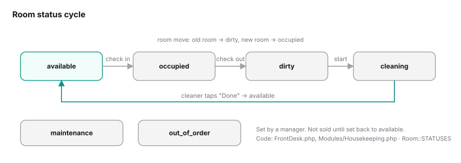

# Features: rules and where the code is

Business rules are agreed with the owner (claude.ai Project: `workflows.md` Q1–Q15, `decisions.md`).
Each section says the rule, the code and the tests. Backend paths are under `backend/app/`, frontend under `frontend/src/`.

## Bookings and front desk

| Rule | Code | Tests |
|---|---|---|
| Prices: base price + rate rules (weekend, season, guest type) per night; taxes inclusive/added | `Services/PriceCalculator`, `Booking/StayQuote`, `Billing/TaxCalculator` | `Hotel/SettingsTest`, `Front/ReservationsTest` |
| **No overbooking** (Q10); a room is blocked until `blocked_until` (check-out + hourly cleaning gap) | `Booking/Availability`, `ReservationService::preview` | `ReservationsTest` |
| Deposit (Q1): fixed / % / first night; `pending` until paid; pending bookings expire (Q2) | `ReservationService`, `reservations:expire` | `ReservationsTest` |
| Pay at check-out: staff with `payments.pay_later`, when the hotel allows it | `ReservationService::payLater` | `ReservationsTest` |
| Changing a booking keeps the deposit; price worked out again (Q3) | `ReservationService::update` | |
| Cancel / no-show with the booking's policy snapshot (Q4, Q5); no-show only after check-in time | `ReservationService::cancel`, `cancellationTerms` | `ReservationsTest` |
| Walk-in: full or deposit up front (Q6); **quick check-in** (name + phone, "Details missing") | `Booking/FrontDesk::walkIn`, `Front/FrontDeskController::walkIn` | `FrontDeskTest` |
| **After-midnight walk-in** (Q13): before the hotel's `night_cutoff` (default 06:00) the walk-in pays for last night | `FrontDesk::nightDate`; `ReservationService` prices from the night date | `FrontDeskTest::test_a_walk_in_after_midnight…` |
| Check-in: clean rooms only; early check-in fee (Q7, waivable); ID photo if required; possible until the check-out time | `FrontDesk::checkIn`, `earlyFee` | `FrontDeskTest` |
| Room move: old room dirty; nights from today at the new type's price | `FrontDesk::moveRoom`, `repriceFromToday` | `FrontDeskTest` |
| Extend stay (later date only, max 90 nights; room must be free) | `FrontDesk::extend` | `FrontDeskTest` |
| Check-out: late fee after check-out time + 30 min (Q7, waivable) | `FrontDesk::checkOut`, `lateFee` | `FrontDeskTest` |
| **Hourly/day-use overstay** (Q15): each started hour at the hourly price after 15 min grace | `FrontDesk::overstay` | `FrontDeskTest::test_an_hourly_guest_who_stays_longer…` |
| **Early check-out** (Q12): unused nights come off the bill (each room's first night always paid), plus the hotel's early check-out fee (waivable); the booking's % discount follows; preview on the check-out screen | `FrontDesk::earlyDeparture`, `shortenStay`, `earlyDeparturePreview` | `FrontDeskTest::test_leaving_early…` |
| Unpaid balance at check-out only with a manager (Q8) → bill `outstanding` | `FrontDesk::checkOut`, `InvoiceService::approveBalance` | `FrontDeskTest` |
| Room board, today's lists, filters (status, arriving, leaving, overdue, free tonight, type, floor, search, sort) | `FrontDeskController::board/today`; `pages/desk/RoomBoardPage.tsx`, `lib/roomFilter.ts` | `test/roomFilter.test.ts`, `test/desk.test.tsx` |

## Money

| Rule | Code | Tests |
|---|---|---|
| Bill opens at check-in with every night, the booking discount, and earlier deposits | `Billing/InvoiceService::openFor` | `FrontDeskTest` |
| Extra charges (also at check-out), discounts within the role's limit (no stacking above it) | `InvoiceService::addCharge`, `components/billing/ChargePanel.tsx` | `FrontDeskTest` |
| Payments in any hotel currency, converted with the latest rate (W9); cash linked to the open cashier shift | `ReservationService::recordPayment`, `Billing/CurrencyConverter`, `Modules/Cashier::sessionForPayment` | `ReservationsTest`, `ModulesTest` |
| **Paying more than owed** needs a yes (Q14) | `ReservationService::assertNotOverpaying`; `lib/api.ts` asks | `FrontDeskTest::test_paying_more_than_owed…` |
| Refund ≤ what was paid; reason required | `recordPayment` | |
| Split a bill per room; cancel ("void") a bill with a reason (stays in the records) | `InvoiceService::split`, `void` | `FrontDeskTest` |
| Payment proof photo/PDF (optional), private files | `Front/PaymentProofController`, `components/payments/PaymentProof.tsx` | `FrontDeskTest` |
| Cashier shift: opening cash, expected vs counted, reason for a difference, manager approval (W10) | `Modules/Cashier` | `ModulesTest` |

## Guests

Duplicate warning (smart `guest_check`), blacklist, ID numbers encrypted and masked in lists, optional encrypted ID photo
(`GuestIdPhotos`, kept as long as the hotel chose), "Details missing" after quick check-in with a reminder automation.
Code: `Front/GuestController`, `Models/Guest`. Tests: `ReservationsTest`, `FrontDeskTest`.

## Rooms and housekeeping

Status cycle (W7): available → occupied → dirty → cleaning → available; maintenance/out of order by managers.
Every dirty room has one open cleaning task (`Housekeeping::taskForDirtyRoom`, `ensureTasks` for rooms made dirty in bulk;
`Room` updated hook in `AppServiceProvider`). Check-out creates the task (`GuestCheckedOut` → `CreateCleaningTasks`).
Tests: `ModulesTest`.

## Staff, roles, security

- Roles and permissions per hotel, no escalation (`Hotel/RoleController`, `StaffController`). Tests: `RolesTest`, `StaffTest`.
- Two-step sign-in (app or email), recovery codes, required for admins (switch); screen lock + PIN switch on shared devices;
  device list, new-device alerts, approved devices only (W7). `Security/*`, `AuthController`. Tests: `Auth/SecurityTest`.
- Rate limits on sign-in, codes and PINs (`AppServiceProvider`, `AuthController`).
- Activity log for every important action (`ActivityLogger`, `LogsActivity`).

## Reports and insights

Dashboard, performance, payments, tax, outstanding, cancellations, guests, branches, daily manager report, forecast with
"usually by now", targets, staff audit, my shift / my work, accounting journal (screen totals by the database; every line in
the download), custom report builder, saved views, scheduled reports (email/Telegram), smart alerts, drill-down per number.
Code: `Reports/Metrics`, `Reports/Insights`, `Reports/CustomReportEngine`, `Reports/Automation`, `Http/Controllers/Api/Reports/*`,
`pages/reports/*`. Max 400 days per report. Tests: `Reports/ReportsTest`, `Reports/AutomationTest`; speed: `tests/Performance`.

## Automation and smart features

- 38+ ready-made automations (`config/automations.php`, `Automation/AutomationEvents` for events, `AutomationSchedule` for timed ones),
  rule builder (`RuleEngine`), quiet hours, approvals. Every automation is also a Super Admin switch. Tests: `Automation/AutomationsTest`.
- Smart hints with "Why?" (`Smart/SmartHints`, `config/smart.php`, `components/ui/SmartHints.tsx`). Tests: `Smart/SmartHintsTest`.
- Notifications: bell (`app_notifications`), email (SMTP from Super Admin → Settings → Emails, or `.env`), Telegram bot
  (link with a code from My profile; polled every minute). `Notify/*`.

## Super Admin (HotelMS team)

Command center, hotels (create with plan/trial, suspend, close, reopen, notes, live data with a reason, log in as hotel),
plans and per-room pricing, subscription payments and invoices, switches and banners, support inbox, releases ("What's new"),
content, team and permissions, platform settings (branding, Telegram, SMTP – Owner only), system health, activity log,
**developer docs** (this folder, rendered by `Admin/DocsController` – Markdown to safe HTML, raw HTML stripped, `images/*.svg` put inline as pictures; `pages/admin/DocsPage.tsx`; Owner + `docs.view`),
**watchdog** (security, bugs, data leaks: bell for all, Telegram + email for serious ones). Code: `Http/Controllers/Api/Admin/*`,
`pages/admin/*`. Tests: `tests/Feature/Admin/*`.

## Help and staff guides

Help → **How to use**: guides per topic in very easy English, filtered by the person's permissions and the hotel's modules
(`lib/guides.ts`, `i18n/locales/en.guide.json`, `pages/help/HelpPage.tsx`). Help → **Ask us**: support requests.
Topics with `pic: true` show a screenshot `frontend/public/guide/<key>.webp` with orange numbers that match the steps.
Tests: `test/guides.test.tsx` (every topic has text; every picture file exists; people see only their topics).
