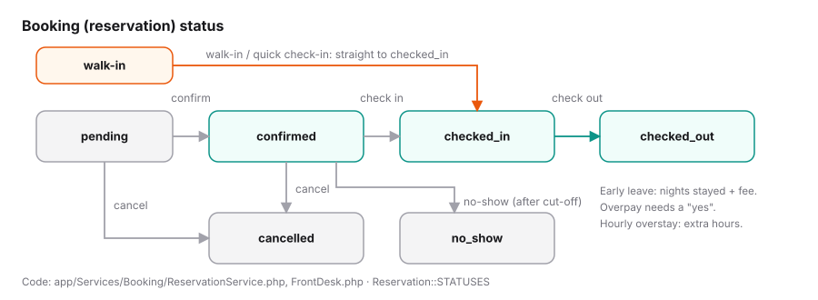

# Features: rules and where the code is

Business rules are agreed with the owner (claude.ai Project: `workflows.md` Q1–Q15, `decisions.md`).
Each section says the rule, the code and the tests. Backend paths are under `backend/app/`, frontend under `frontend/src/`.

## Bookings and front desk

| Rule | Code | Tests |
|---|---|---|
| Prices: base price + rate rules (weekend, season, guest type) per night; taxes inclusive/added | `Services/PriceCalculator`, `Booking/StayQuote`, `Billing/TaxCalculator` | `Hotel/SettingsTest`, `Front/ReservationsTest` |
| **No overbooking** (Q10); a room is blocked until `blocked_until` (check-out + hourly cleaning gap) | `Booking/Availability`, `ReservationService::preview` | `ReservationsTest` |
| Deposit (Q1): fixed / % / first night; `pending` until paid; pending bookings expire (Q2) | `ReservationService`, `reservations:expire` | `ReservationsTest` |
| Pay at check-out: staff with `payments.pay_later`, when the hotel allows it | `ReservationService::payLater` | `ReservationsTest` |
| Changing a booking keeps the deposit; price worked out again (Q3) | `ReservationService::update` | |
| Cancel / no-show with the booking's policy snapshot (Q4, Q5); no-show only after check-in time. A cancelled / no-show booking's `balance` = what goes back (negative) or 0: the fee is kept from what was paid, an unpaid fee is not a debt (decision 8); the screen shows **To give back to the guest** | `ReservationService::cancel`, `cancellationTerms`, `ReservationPresenter::balance` | `ReservationsTest`, `test/bookingsReview.test.tsx` |
| Walk-in: full or deposit up front (Q6); **quick check-in** (name + phone, "Details missing"); a phone that matches an old guest offers **Use this guest** (no second copy) | `Booking/FrontDesk::walkIn`, `Front/FrontDeskController::walkIn`; `WalkInPage` `PhoneMatch`, `lib/phone.ts` | `FrontDeskTest`, `test/openStay.test.tsx` |
| **No end date / open stay** (Q16): a nightly walk-in pays the first night; `reservations.open_stay`; every 5 min `stays:roll-open` adds one night when the guest is still in 30 min after the check-out time (like Extend, so a booked room is never double-booked); no early check-out fee; leaving after today's check-out time = late fee (`FrontDesk::dueOut`), not a night. Listed in Leaving every day. Messages (automations): `open_stay_room_booked` (a day before the room is booked, and when no night could be added), `open_stay_check` (every N nights, default 14) | `FrontDesk::walkIn`, `rollOpenStay`, `freeOneMoreNight`, `dueOut`; `Console/Commands/RollOpenStays` | `FrontDeskTest::test_an_open_stay…` |
| **After-midnight walk-in** (Q13): before the hotel's `night_cutoff` (default 06:00) the walk-in pays for last night | `FrontDesk::nightDate`; `ReservationService` prices from the night date | `FrontDeskTest::test_a_walk_in_after_midnight…` |
| Check-in: clean rooms only; early check-in fee (Q7, waivable; percent fees at most 100%); a booked guest arriving after midnight, before the night cut-off, on the check-in day pays **last night as a full night** (Q17, line "Last night (arrived after midnight)"); ID photo if required; possible until the check-out time | `FrontDesk::checkIn`, `earlyFee` | `FrontDeskTest::test_a_booked_guest_arriving_after_midnight…` |
| Room move: old room dirty; nights from today at the new type's price | `FrontDesk::moveRoom`, `repriceFromToday` | `FrontDeskTest` |
| Extend stay (later date only, max 90 nights; room must be free); **+1 night** in one tap on the room panel and on the Leaving list ("Still staying?": Staying / Leaving) | `FrontDesk::extend`; `RoomBoardPage` `PlusNight` | `FrontDeskTest`, `test/openStay.test.tsx` |
| Check-out: late fee after check-out time + 30 min (Q7, waivable) | `FrontDesk::checkOut`, `lateFee` | `FrontDeskTest` |
| **Hourly/day-use overstay** (Q15): each started hour at the hourly price after 15 min grace | `FrontDesk::overstay` | `FrontDeskTest::test_an_hourly_guest_who_stays_longer…` |
| **Early check-out** (Q12): unused nights come off the bill (each room's first night always paid), plus the hotel's early check-out fee (waivable); the booking's % discount follows; preview on the check-out screen | `FrontDesk::earlyDeparture`, `shortenStay`, `earlyDeparturePreview` | `FrontDeskTest::test_leaving_early…` |
| Unpaid balance at check-out only with a manager (Q8) → bill `outstanding` | `FrontDesk::checkOut`, `InvoiceService::approveBalance` | `FrontDeskTest` |
| Room board, today's lists, filters (status, arriving, leaving, overdue, free tonight, type, floor, search, sort) | `FrontDeskController::board/today`; `pages/desk/RoomBoardPage.tsx`, `lib/roomFilter.ts` | `test/roomFilter.test.ts`, `test/desk.test.tsx` |
| **Room panel**: a guest inside → **Check out** (opens the booking's check-out) and **Stay details**; free room with an arrival → Check in. **Front desk mode** tiles: Check in, Check out, Walk-in, Take payment, **Charge a room**, Room board (each by permission). The header search is hidden for a role with nothing to search (Restaurant / Bar). Walk-in after midnight shows "pays for last night" (Q13) | `pages/desk/RoomBoardPage.tsx`, `FrontDeskModePage.tsx`, `WalkInPage.tsx`, `components/layout/Search.tsx` | `test/frontDeskReview.test.tsx` |
| **Room board on another day** (`?date=`): who stays in each room that night (booked, staying or left), read only, not polled; today = live board | `FrontDeskController::boardOn`; `RoomBoardPage` `DayPicker` | `FrontDeskTest::test_lists_filter_by_date…`, `test/dateFilters.test.tsx` |
| **Date filter** on lists (one component: Any time, Today, Yesterday, This week, This month, Last month, From–To): bills (`from`/`to` = bill date), payments, cashier shifts, activity log, guests (`stayed_from`/`stayed_to` = stayed on any of those days) | `components/ui/DateRangeFilter.tsx`, `lib/dateRange.ts` | same |

## Money

| Rule | Code | Tests |
|---|---|---|
| Bill opens at check-in with every night, the booking discount, and earlier deposits | `Billing/InvoiceService::openFor` | `FrontDeskTest` |
| Extra charges (also at check-out), discounts within the role's limit (no stacking above it) | `InvoiceService::addCharge`, `components/billing/ChargePanel.tsx` | `FrontDeskTest` |
| **Quick charges**: charge types marked *Quick button* (Settings → Charges, with order) are one-tap buttons on the room panel and on **Charge a room** (`/charge`). A type without a price (taxi) asks the amount; **Other** = name + amount. Goes on the room's bill (the split bill of that room if any). The person who added it can **undo** for 10 min. Permission `charges.room` (Branch Manager, Receptionist, new default role **Restaurant / Bar**, which only charges rooms and starts on `/charge`) | `Front/QuickChargeController`, `components/billing/QuickCharge.tsx`, `pages/desk/ChargeRoomPage.tsx` | `FrontDeskTest::test_quick_buttons…`, `test_restaurant_and_bar…`, `test/quickCharge.test.tsx` |
| Payments in any hotel currency, converted with the latest rate (W9); cash linked to the open cashier shift | `ReservationService::recordPayment`, `Billing/CurrencyConverter`, `Modules/Cashier::sessionForPayment` | `ReservationsTest`, `ModulesTest` |
| **Paying more than owed** needs a yes (Q14) | `ReservationService::assertNotOverpaying`; `lib/api.ts` asks | `FrontDeskTest::test_paying_more_than_owed…` |
| Refund ≤ what was paid; reason required | `recordPayment` | |
| Split a bill per room; cancel ("void") a bill with a reason (stays in the records) | `InvoiceService::split`, `void` | `FrontDeskTest` |
| Printed invoice: hotel TIN/VAT, the guest's **name only** (phone and ID stay on the registration card; the bill API does not send the ID number), and an optional **company that pays + buyer TIN** (`invoices.buyer_company`, `buyer_tin`; `PUT /invoices/{id}/buyer`, permission `invoices.print`) | `Front/InvoiceController::buyer`, `InvoicePresenter`, `pages/billing/InvoicePrintPage.tsx` | `FrontDeskTest::test_the_bill_shows_a_paying_company…`, `test/desk.test.tsx` |
| Payment proof photo/PDF (optional), private files | `Front/PaymentProofController`, `components/payments/PaymentProof.tsx` | `FrontDeskTest` |
| Cashier shift: opening cash, expected vs counted, reason for a difference, manager approval (W10) | `Modules/Cashier` | `ModulesTest` |

## Robustness (launch recheck)

- A list in a link's filters (`?q[]=x`) answers 422 "One of the filters in the link is not valid" (`Middleware/ScalarQuery`), never a server error.
- `FuzzSweepTest` sends broken data (lists, 5,000-letter text, nested objects, negative numbers) to every API route that changes something, as the demo hotel's admin and as Super Admin: never a 500.
- A screen that breaks shows "Something went wrong on this screen" with Reload (`components/layout/RouteError.tsx`, the router's `errorElement`); after an update, old screen files are gone, so the app reloads once by itself (also for `vite:preloadError`).

## Staff, roles and settings (review notes)

- A Branch Manager editing someone who also works in another branch keeps that other branch (`StaffController::update`).
- Price rules: a Branch Manager only sees and changes rules of their own branch's room types; "All room types" is for the Hotel Admin (`RateRuleController`). Settings lists can give plain-word messages (`ResourceController::messages`).
- Support ("log in as hotel") is not sent to "Set a new password" for a person with a temporary password (server and app).
- The design-system page exists only in development builds.

## Bills after check-out (Q18)

Once the guest has left (or the booking was cancelled / no-show), only people with `invoices.void` (managers) can add or remove bill lines,
also the quick-charge Undo (`InvoiceService::assertMayChangeLines`). Payments and refunds stay possible. The bill screen hides Add charge / Add discount for others.
Bookings show only the end of the guest's ID number (`ReservationPresenter`); the full number is on the guest's page and the registration card.
The technical "API status" card on the dashboard is only for the HotelMS team. The Super Admin hotel overview shows 5 staff with "See all staff"; Log in as hotel can choose any of them.

## Guests

Duplicate warning (smart `guest_check`), blacklist, ID numbers encrypted and masked in lists, optional encrypted ID photo
(`GuestIdPhotos`, kept as long as the hotel chose), "Details missing" after quick check-in with a reminder automation.
Guests are shared by the whole hotel, but a guest's **stay history** shows only the branches the person works in.
Code: `Front/GuestController`, `Models/Guest`. Tests: `ReservationsTest`, `FrontDeskTest`.

## Rooms and housekeeping

Status cycle (W7): available → occupied → dirty → cleaning → available; maintenance/out of order by managers.
Every dirty room has one open cleaning task (`Housekeeping::taskForDirtyRoom`, `ensureTasks` for rooms made dirty in bulk;
`Room` updated hook in `AppServiceProvider`). Check-out creates the task (`GuestCheckedOut` → `CreateCleaningTasks`).
**One open task per room and kind** (owner, QA 8 Nov): adding or changing a task into a kind (cleaning / inspection / maintenance) the room already has open (not done) is refused with 422, the message names the room and kind, and `existing_task_id` lets the Assign screen link to it (`Housekeeping::openTask`, `HousekeepingController::alreadyOpen`); an automation rule then adds nothing (`RuleEngine`).
Tests: `ModulesTest`, `AutomationsTest`, `hkDuplicateTask.test.tsx`.

## Staff, roles, security

- Roles and permissions per hotel, no escalation (`Hotel/RoleController`, `StaffController`). Tests: `RolesTest`, `StaffTest`.
- Two-step sign-in (app or email), recovery codes, required for admins (switch); screen lock + PIN switch on shared devices;
  device list, new-device alerts, approved devices only (W7). `Security/*`, `AuthController`. Tests: `Auth/SecurityTest`.
- Rate limits on sign-in, codes and PINs (`AppServiceProvider`, `AuthController`).
- PINs: a PIN set by someone else (manager, `attendance_pin_set_by`) works on the attendance kiosk but never for PIN switch (taking over a shared device). "PIN already used" answers are limited to 3 per person per day, so other people's PINs cannot be found by trying (`Attendance::setPin`, `ownPin`). Housekeeping tasks go only to active people with `housekeeping.own_tasks`; roster only active staff, within a year.
- Activity log for every important action (`ActivityLogger`, `LogsActivity`), in plain words ("Bill line removed: …", "Booking changed: …"; labels in `LogsActivity::ACTIVITY_LABELS`, never class names).

## Reports and insights

Dashboard, performance, payments, tax, outstanding, cancellations, guests, branches, daily manager report, forecast with
"usually by now", targets, staff audit, my shift / my work, accounting journal (screen totals by the database; every line in
the download), custom report builder, saved views, scheduled reports (email/Telegram), smart alerts, drill-down per number.
Code: `Reports/Metrics`, `Reports/Insights`, `Reports/CustomReportEngine`, `Reports/Automation`, `Http/Controllers/Api/Reports/*`,
`pages/reports/*`. Max 400 days per report. Tests: `Reports/ReportsTest`, `Reports/AutomationTest`; speed: `tests/Performance`.

## Automation and smart features

- 38+ ready-made automations (`config/automations.php`, `Automation/AutomationEvents` for events, `AutomationSchedule` for timed ones),
  rule builder (`RuleEngine`), quiet hours, approvals (two managers approving at once: only the first acts; price suggestions expire by the hotel's date). Smart "tonight" counts only guests leaving tomorrow or later. Every automation is also a Super Admin switch. Tests: `Automation/AutomationsTest`.
- Smart hints with "Why?" (`Smart/SmartHints`, `config/smart.php`, `components/ui/SmartHints.tsx`). Tests: `Smart/SmartHintsTest`.
- Notifications: bell (`app_notifications`), email (SMTP from Super Admin → Settings → Emails, or `.env`), Telegram bot
  (link with a code from My profile; polled every minute). `Notify/*`.

## Plans and limits

Free / Starter / Pro (recommended) / Business (migration `2026_11_26_000001_add_balanced_plans`). Core work is in every plan.
Limits: rooms, branches, staff, files (`max_storage_mb`; `StorageQuota` counts payment proofs, ID photos and the logo).
Plan features are Super Admin switches at plan level: `feature.telegram`, `feature.multi_currency`, `feature.full_reports`
(forecast, staff audit, accounting, branch comparison, CSV/Excel and list downloads), `feature.accountant_role` (new Accountant
staff only; people who have it keep it), `feature.custom_reports`, `feature.branding` (no "Powered by"), `feature.priority_support`.
A hotel switch or `limit.*` switch overrides the plan for one hotel. Over a limit = refusal with `PlanLimits::message` (WhatsApp /
email from platform settings `whatsapp`, `support_email`); nothing is removed. No online billing. Tests: `Admin/BalancedPlansTest`.

## Getting started (new hotels)

After the first sign-in a Hotel Admin goes through the setup walkthrough (`/setup`, `HotelSetup`). Then the dashboard shows a
"Getting started" checklist (`GettingStarted`: setup, rooms, logo, a staff member, first booking, first check-in, first payment,
two-step sign-in), each known from the hotel's own data. "Hide" stores `getting_started_dismissed` in the hotel settings; it also goes
away when all is done. `GET /getting-started`, `POST /getting-started/dismiss` (Hotel Admin only). Tests: `Hotel/GettingStartedTest`.

## Hotel sign-up

Super Admin → Settings → Sign-up (Owner only): **Off** (default; the website says "Contact us") / **Approval** / **Open**.
A new hotel gets the Free plan (a trial only when "Give new hotels a free trial" is on), one branch and the owner as Hotel Admin
with their own password. `hotels.signup_status`: `unverified` → (`pending` →) `approved`, or `rejected`; `null` = made by the team.
Sign-in is refused until the email is confirmed (`email_unverified`, with "Send the link again"), while waiting (`signup_pending`)
and when refused (`signup_rejected`). Pending hotels: approve, or refuse with a reason; both are emailed. Security log:
`signup`, `signup_verified`, `signup_approved`, `signup_rejected`. No captcha, no cookies before the form is sent: hidden field +
form time + rate limit. Safety: no email or Telegram for a hotel until it is confirmed (and approved) – `Hotel::maySendMessages()` in `Notifier` and
`AutomationEvents::mail`. Daily `hotelms:signup-cleanup` (03:45, `Signup/SignupCleanup`): removes sign-ups not confirmed in 7 days
(never one with guests or bookings), flags Free hotels nobody signed in to for 90 days (`hotels.inactive_since`; Command center +
Hotels `?inactive=1`; cleared at the next sign-in). Guest data is never deleted automatically.
Code: `Services/Signup/SelfSignup`, `SignupController`, `pages/SignupPages.tsx`,
`pages/admin/SignupsPage.tsx`. Tests: `Auth/SelfSignupTest`, `Auth/SignupSafetyTest`.

## Super Admin (HotelMS team)

Command center, hotels (create with plan/trial, suspend, close, reopen, notes, live data with a reason, log in as hotel),
plans and per-room pricing, subscription payments and invoices, switches and banners, support inbox, releases ("What's new"),
content, team and permissions, platform settings (branding incl. logo and e-mail sender, Telegram bot, SMTP and two-step sign-in for admins – Owner only, checked by the server `PlatformSettingsController::OWNER_ONLY`; other team members see "Only the Owner can change this"; Finance keeps trials, grace days, demo and support contacts), system health, activity log,
**developer docs** (this folder, rendered by `Admin/DocsController` – Markdown to safe HTML, raw HTML stripped, `images/*.svg` put inline as pictures; `pages/admin/DocsPage.tsx`; Owner + `docs.view`),
**watchdog** (security, bugs, data leaks: bell for all, Telegram + email for serious ones). Code: `Http/Controllers/Api/Admin/*`,
`pages/admin/*`. Tests: `tests/Feature/Admin/*`.

## Help and staff guides

Help → **How to use**: guides per topic in very easy English, filtered by the person's permissions and the hotel's modules
(`lib/guides.ts`, `i18n/locales/en.guide.json`, `pages/help/HelpPage.tsx`). Help → **Ask us**: support requests.
Topics with `pic: true` show a screenshot `frontend/public/guide/<key>.webp` with orange numbers that match the steps.
Tests: `test/guides.test.tsx` (every topic has text; every picture file exists; people see only their topics).
